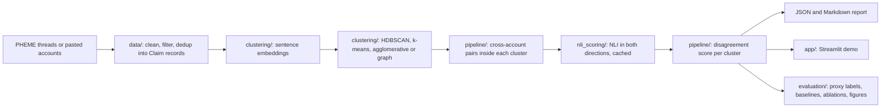

# Cross-Account Inconsistency Detector

**UML501 Machine Learning, group project.**

Given several free-text accounts of one event (witness statements, reports, tweets), the system
finds where those accounts disagree. It clusters claims by sub-event without supervision, scores
claim pairs inside each cluster with a natural language inference (NLI) model, and lists the
clusters whose accounts contradict each other, with the conflicting statements quoted and
attributed.

It does **not** decide which account is correct, assign fault, write a merged narrative, or use a
generative language model in the detection loop.

- Full write-up: [`reports/REPORT.md`](reports/REPORT.md)
- Error analysis and manual audit: [`reports/ERROR_ANALYSIS.md`](reports/ERROR_ANALYSIS.md)
- Slide outline: [`reports/PRESENTATION_OUTLINE.md`](reports/PRESENTATION_OUTLINE.md)
- Data schema and cleaning: [`data/SCHEMA.md`](data/SCHEMA.md)

## Architecture



## Quick start

Commands are for Windows PowerShell. On Linux or macOS use `python3` and `.venv/bin/python`.

```powershell
py -3.11 -m venv .venv
```

```powershell
.venv\Scripts\python -m pip install torch==2.6.0 --index-url https://download.pytorch.org/whl/cu124
```

(For a machine without an NVIDIA GPU use `https://download.pytorch.org/whl/cpu` instead.)

```powershell
.venv\Scripts\python -m pip install -r requirements.txt
```

```powershell
.venv\Scripts\python -m pytest -q tests
```

```powershell
.venv\Scripts\python run_all.py --sample
```

```powershell
.venv\Scripts\python run_all.py
```

```powershell
.venv\Scripts\python -m streamlit run app/streamlit_app.py
```

### Data and models

Datasets are read from local folders and are never downloaded by the code:

```
data/raw/pheme_v2/all-rnr-annotated-threads/<event>-all-rnr-threads/{rumours,non-rumours}/<thread>/...
data/raw/pheme_v1/pheme-rnr-dataset/<event>/...                 (fallback, no veracity)
data/raw/multinli_1.0/multinli_1.0/multinli_1.0_dev_{matched,mismatched}.jsonl
pheme_rte_datasets_2016/pheme_rte_datasets_2016/per_event_splits/pheme_rte_<event>_en.xml   (in the repo)
```

Models download from HuggingFace on first use (about 1.2 GB in total) and are cached. To work
offline, put a snapshot in `models/<org>__<name>` (for example
`models/cross-encoder__nli-deberta-v3-base`); it is used automatically. Model names, paths and
every threshold are in [`configs/default.yaml`](configs/default.yaml). `data/raw/`, `models/` and
`outputs/` are gitignored.

| Role | Model |
|---|---|
| NLI scorer | `cross-encoder/nli-deberta-v3-base` |
| Embeddings (default) | `sentence-transformers/all-MiniLM-L6-v2` |
| Embeddings (comparison) | `sentence-transformers/all-mpnet-base-v2` |
| NLI comparison (optional, not run) | `roberta-large-mnli`, via `--compare-nli` |

## Commands

| Goal | Command |
|---|---|
| Everything, full data | `python run_all.py` |
| Small subset, real models | `python run_all.py --sample` |
| Force CPU | `python run_all.py --sample --cpu` |
| No downloads at all (mock models) | `python run_all.py --mock --sample` |
| Only some stages | `python run_all.py --stages nli rte` (also `clustering`, `pipeline`, `reports`) |
| Regenerate the results tables | `python -m evaluation.make_tables` |
| Fine-tune NLI, leave-one-event-out (about 10 minutes per event on GPU) | `python -m training.finetune_nli` |
| Fine-tune the all-events demo model (after the folds) | `python -m training.finetune_nli --skip-folds --all-events` |
| Use the fine-tuned model | `python -m pipeline.run --input examples/witness_accounts.txt --finetuned`, or `finetune.use_finetuned: true`, or the checkbox in the app |
| One PHEME event | `python -m pipeline.run --event germanwings-crash --rumours-only` |
| Your own accounts | `python -m pipeline.run --input examples/witness_accounts.txt` |
| Demo | `python -m streamlit run app/streamlit_app.py` |
| Tests | `python -m pytest -q tests` |
| Rebuild the EDA notebook outputs | `python -m jupyter nbconvert --to notebook --execute --inplace notebooks/01_eda.ipynb` |

`--input` takes a text file with one account per paragraph (an optional `Name:` prefix names the
account) or a JSON list of `{"account_id", "text"}`. Reports go to `outputs/reports/`. Full-run
metrics go to `reports/results/` and figures to `reports/figures/`; sample runs write to
`outputs/sample/` so they never overwrite the reported results.

### Runtimes (measured)

| Run | Hardware | Time |
|---|---|---|
| `run_all.py --mock --sample` | any | under 1 minute |
| `run_all.py --sample --cpu`, cold caches | laptop CPU | about 7 minutes (424 s, measured before the labelled-pair stage was added) |
| `run_all.py`, cold caches | RTX 4050 laptop GPU | about 20 minutes, plus model downloads and a first read of PHEME that takes several minutes |
| `run_all.py`, warm caches | RTX 4050 laptop GPU | about 5 minutes (279 s) |
| Unit tests | any | about 15 seconds |

## Evaluation data

- **PHEME RTE labelled pairs (primary).** `pheme_rte_datasets_2016/` has 5,413 tweet pairs from the
  four events labelled entailment, contradiction or unknown. The labels are assigned through the
  rumour stories the two tweets belong to, so they are human-defined but coarser than
  sentence-level NLI.
- **Veracity proxies (secondary).** The PHEME thread release itself has no pair labels and no
  stance labels, only the rumour story, its veracity and a turnaround flag. A cluster that mixes a
  true and a false story counts as disagreement-positive. This is a weak signal and is used for
  the cluster-level view only.

## Results summary

Four events (Ottawa shooting, Sydney siege, Charlie Hebdo, Germanwings crash). Numbers are from
`reports/results/*.json`; every table is in [`reports/RESULTS_TABLES.md`](reports/RESULTS_TABLES.md).

| Check | Result |
|---|---|
| NLI scorer, MultiNLI validation matched / mismatched | accuracy 0.9001 / 0.9004 |
| NLI scorer on 5,413 labelled PHEME pairs, contradiction flags (base rate 25.5%) | precision 0.619, recall 0.329 |
| Same pairs through the pipeline (agglomerative clusters, then NLI) | precision 0.672, recall 0.132 |
| Labelled "unknown" pairs wrongly flagged, NLI alone vs pipeline | 9.4% vs 1.2% |
| Labelled contradictions that land in the same cluster: agglomerative / HDBSCAN | 55.1% / 9.9% |
| Pairs sent to NLI, in-cluster vs all pairs (same 1,283 claims) | 38,526 vs 207,385 (82% fewer) |
| Cluster-level detection vs veracity proxy (102 clusters, 28 positive) | precision 0.434, recall 0.821, F1 0.568 |
| Baselines on the same clusters | flag everything: F1 0.431; random: F1 0.357 |
| Manual audit of 40 random flagged pairs (earlier HDBSCAN configuration) | 27.5% genuine, 15% time-driven, 57.5% false alarms |

What this means:

- When the system flags a pair, it is a labelled contradiction about two times in three. It finds
  only a minority of the contradictions that exist.
- Clustering is a precision filter and a cost saver. It cannot add recall, and it loses the
  contradictions it splits apart.
- The clustering that best reproduces the annotated rumour stories (HDBSCAN) is the worst for this
  task, because contradicting tweets belong to different stories. The default is agglomerative.
- Fine-tuning the NLI model on the labelled pairs, tested on held-out events, doubles
  contradiction recall (0.31 to 0.64, precision 0.58 to 0.63) and triples pipeline recall (0.12
  to 0.36). It is slightly worse on one event of four, and the labels are story-level, so it may
  partly learn story cues. Details in section 6.10 of the report.


Every report also opens with a **findings summary** built only from the statements: what the
accounts agree on, where they conflict, what only one account says, and what the summary cannot
tell you.

## Repository layout

```
.
├── docs/          project brief and work division
├── data/          loaders (PHEME, PHEME RTE, MultiNLI), cleaning, Claim schema, proxy labels, SCHEMA.md (+ raw/, gitignored)
├── nli_scoring/   NLI scorer (real and mock), cache
├── clustering/    embeddings, clustering algorithms, cluster labels, metrics
├── pipeline/      config, disagreement score, findings summary, end-to-end run, report rendering
├── evaluation/    experiments, baselines, ablations, plots
├── training/      NLI fine-tuning on PHEME RTE (leave one event out)
├── notebooks/     01_eda.ipynb
├── app/           Streamlit demo
├── examples/      sample witness accounts
├── reports/       REPORT.md, ERROR_ANALYSIS.md, PRESENTATION_OUTLINE.md, results/, figures/
├── tests/         unit tests (mock models, no network)
├── configs/       default.yaml, sample.yaml
├── models/        optional local model snapshots (gitignored)
├── requirements.txt
└── run_all.py
```

## Known limitations

Recall is low (the pipeline finds about 13% of labelled contradictions). The labelled pairs are
story-level, and the default clustering was chosen on them without a held-out split. The system is
English-only, uses source tweets only, has no notion of time (an update looks like a dispute), and
samples at most 400 pairs per cluster. A flagged pair is a prompt for a person to look, not a
finding. Details are in section 8 of the report.
