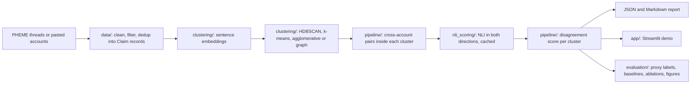
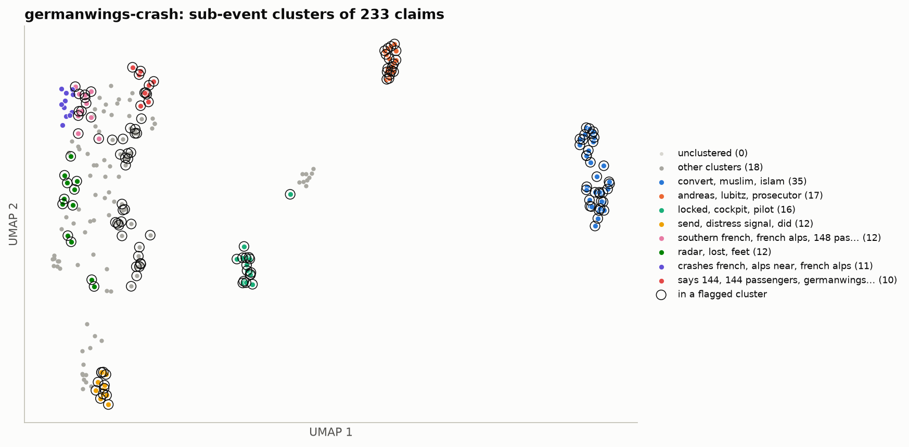
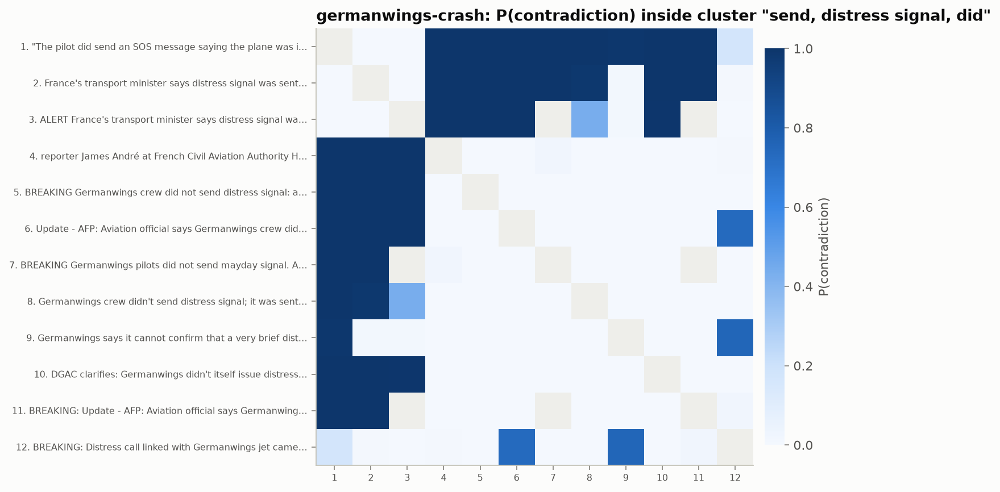

# Cross-Account Inconsistency Detector

**UML501 Machine Learning, group project.**

Given several free-text accounts of one event (witness statements, reports, tweets), the system
finds where those accounts disagree. It clusters claims by sub-event without supervision, scores
claim pairs inside each cluster with a natural language inference (NLI) model, and lists the
clusters whose accounts contradict each other, with the conflicting statements quoted and
attributed.

It does **not** decide which account is correct, assign fault, write a merged narrative, or use a
generative language model in the detection loop.

- Full write-up: [`reports/REPORT.md`](reports/REPORT.md)
- Error analysis and manual audit: [`reports/ERROR_ANALYSIS.md`](reports/ERROR_ANALYSIS.md)
- Slide outline: [`reports/PRESENTATION_OUTLINE.md`](reports/PRESENTATION_OUTLINE.md)
- Data schema and cleaning: [`data/SCHEMA.md`](data/SCHEMA.md)

## Architecture



## Quick start

Commands are for Windows PowerShell. On Linux or macOS use `python3` and `.venv/bin/python`.

```powershell
py -3.11 -m venv .venv
```

```powershell
.venv\Scripts\python -m pip install torch==2.6.0 --index-url https://download.pytorch.org/whl/cu124
```

(For a machine without an NVIDIA GPU use `https://download.pytorch.org/whl/cpu` instead.)

```powershell
.venv\Scripts\python -m pip install -r requirements.txt
```

```powershell
.venv\Scripts\python -m pytest -q tests
```

```powershell
.venv\Scripts\python run_all.py --sample
```

```powershell
.venv\Scripts\python run_all.py
```

```powershell
.venv\Scripts\python -m streamlit run app/streamlit_app.py
```

### Data and models

Datasets are read from local folders and are never downloaded by the code:

```
data/raw/pheme_v2/all-rnr-annotated-threads/<event>-all-rnr-threads/{rumours,non-rumours}/<thread>/...
data/raw/pheme_v1/pheme-rnr-dataset/<event>/...                 (fallback, no veracity)
data/raw/multinli_1.0/multinli_1.0/multinli_1.0_dev_{matched,mismatched}.jsonl
```

Models download from HuggingFace on first use (about 1.2 GB in total) and are cached. To work
offline, put a snapshot in `models/<org>__<name>` (for example
`models/cross-encoder__nli-deberta-v3-base`); it is used automatically. Model names, paths and
every threshold are in [`configs/default.yaml`](configs/default.yaml). `data/raw/`, `models/` and
`outputs/` are gitignored.

| Role | Model |
|---|---|
| NLI scorer | `cross-encoder/nli-deberta-v3-base` |
| Embeddings (default) | `sentence-transformers/all-MiniLM-L6-v2` |
| Embeddings (comparison) | `sentence-transformers/all-mpnet-base-v2` |
| NLI comparison (optional, not run) | `roberta-large-mnli`, via `--compare-nli` |

## Commands

| Goal | Command |
|---|---|
| Everything, full data | `python run_all.py` |
| Small subset, real models | `python run_all.py --sample` |
| Force CPU | `python run_all.py --sample --cpu` |
| No downloads at all (mock models) | `python run_all.py --mock --sample` |
| Only some stages | `python run_all.py --stages nli clustering` (also `pipeline`, `reports`) |
| One PHEME event | `python -m pipeline.run --event germanwings-crash --rumours-only` |
| Your own accounts | `python -m pipeline.run --input examples/witness_accounts.txt` |
| Demo | `python -m streamlit run app/streamlit_app.py` |
| Tests | `python -m pytest -q tests` |
| Rebuild the EDA notebook outputs | `python -m jupyter nbconvert --to notebook --execute --inplace notebooks/01_eda.ipynb` |

`--input` takes a text file with one account per paragraph (an optional `Name:` prefix names the
account) or a JSON list of `{"account_id", "text"}`. Reports go to `outputs/reports/`. Full-run
metrics go to `reports/results/` and figures to `reports/figures/`; sample runs write to
`outputs/sample/` so they never overwrite the reported results.

### Runtimes (measured)

| Run | Hardware | Time |
|---|---|---|
| `run_all.py --mock --sample` | any | under 1 minute |
| `run_all.py --sample --cpu`, cold caches | laptop CPU | about 7 minutes (424 s) |
| `run_all.py`, cold caches | RTX 4050 laptop GPU | about 20 minutes, plus model downloads and a first read of PHEME that takes several minutes |
| `run_all.py`, warm caches | RTX 4050 laptop GPU | about 4 minutes (231 s) |
| Unit tests | any | about 15 seconds |

## What PHEME contains, and the proxy labels

Checked on the local files: rumour threads are annotated with the rumour story (`category`), its
veracity (true / false / unverified) and a turnaround flag. There are **no reply stance labels and
no entailment or contradiction labels**. Evaluation therefore uses proxies, which are weaker than
real labels and are never presented as NLI gold:

- **Pair level:** a debunking tweet against another tweet of the same false story is
  contradiction-like; two tweets of the same true story are entailment-like; tweets from different
  stories are neutral-like.
- **Cluster level:** a cluster that mixes a true and a false story, or holds a debunk next to its
  rumour, is disagreement-positive.

## Results summary

Four events (Ottawa shooting, Sydney siege, Charlie Hebdo, Germanwings crash). Numbers are from
`reports/results/*.json`.

| Check | Result |
|---|---|
| NLI scorer, MultiNLI validation matched / mismatched | accuracy 0.9001 / 0.9004 |
| NLI scorer, PHEME proxy pairs (3,405) | accuracy 0.445, macro-F1 0.322 |
| Best clustering vs rumour stories (MiniLM + HDBSCAN, mean of 4 events) | ARI 0.424, NMI 0.706, silhouette 0.162 |
| Pairs sent to NLI, in-cluster vs all pairs (same 1,283 claims) | 9,698 vs 207,385 (95% fewer) |
| Flagged pairs about the same rumour story, in-cluster vs all pairs | 27.1% vs 2.1% |
| Cluster-level detection vs proxy (172 clusters, 68 positive) | precision 0.510, recall 0.779, F1 0.616 |
| Baselines on the same clusters | flag everything: F1 0.567; random: F1 0.477 |
| Manual audit of 40 random flagged pairs | 27.5% genuine, 15% time-driven, 57.5% false alarms |

What this means:

- The scorer is as good as published on MultiNLI, but on tweets it often labels unrelated
  statements as contradictions.
- Clustering is what makes the output usable: far fewer comparisons, and flagged pairs that are
  mostly on-topic. It also splits about half of the rumour-versus-debunk pairs apart.
- Against the veracity proxy, detection is only modestly better than trivial baselines, and about
  half of all clusters get flagged. The proxy also misjudges the detector in both directions; see
  the error analysis.




## Repository layout

```
.
├── docs/          project brief and work division
├── data/          loaders, cleaning, Claim schema, proxy labels, SCHEMA.md (+ raw/, gitignored)
├── nli_scoring/   NLI scorer (real and mock), cache
├── clustering/    embeddings, clustering algorithms, cluster labels, metrics
├── pipeline/      config, disagreement score, end-to-end run, report rendering
├── evaluation/    experiments, baselines, ablations, plots
├── notebooks/     01_eda.ipynb
├── app/           Streamlit demo
├── examples/      sample witness accounts
├── reports/       REPORT.md, ERROR_ANALYSIS.md, PRESENTATION_OUTLINE.md, results/, figures/
├── tests/         40 unit tests (mock models, no network)
├── configs/       default.yaml, sample.yaml
├── models/        optional local model snapshots (gitignored)
├── requirements.txt
└── run_all.py
```

## Known limitations

No gold contradiction labels exist for PHEME, so all PHEME scores are against proxies. The system
is English-only, uses source tweets only, has no notion of time (an update looks like a dispute),
and samples at most 400 pairs per cluster. A flagged pair is a prompt for a person to look, not a
finding. Details are in section 8 of the report.
