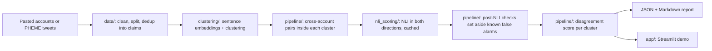

# Cross-Account Inconsistency Detector

Given several free-text accounts of one event (witness statements, reports, tweets), this tool
finds where the accounts disagree. It:

1. splits each account into sentence-level claims;
2. groups claims about the same sub-event, without supervision (sentence embeddings + clustering);
3. scores claim pairs from **different** accounts inside each group with a natural language
   inference (NLI) model;
4. sets aside flagged pairs that match a known non-contradiction pattern (the same quantity in
   other units, "I didn't see", reported speech, different moments, different people), keeping
   them visible with the reason;
5. reports the groups where accounts contradict each other, quoting the conflicting statements
   and who made them.

It does **not** decide which account is correct, assign fault, or write a merged narrative, and
no generative language model is used. A flagged conflict is a prompt for a person to check, not a
finding.



## 1. Install

Python 3.11. Commands are for Windows PowerShell; on Linux or macOS use `python3` and
`.venv/bin/python`.

```powershell
py -3.11 -m venv .venv
```

Install PyTorch first. With an NVIDIA GPU:

```powershell
.venv\Scripts\python -m pip install torch==2.6.0 --index-url https://download.pytorch.org/whl/cu124
```

Without a GPU, use `https://download.pytorch.org/whl/cpu` as the index URL instead. Then:

```powershell
.venv\Scripts\python -m pip install -r requirements.txt
```

Check the install (about 15 seconds, no downloads, mock models):

```powershell
.venv\Scripts\python -m pytest -q tests
```

## 2. Models

Downloaded from Hugging Face on first use (about 1.2 GB in total) and cached:

| Role | Model |
|---|---|
| NLI scorer | `cross-encoder/nli-deberta-v3-base` |
| Sentence embeddings | `sentence-transformers/all-MiniLM-L6-v2` |
| Embeddings used for comparison in the evaluation | `sentence-transformers/all-mpnet-base-v2` |

To work offline, put a model snapshot in `models/<org>__<name>` (for example
`models/cross-encoder__nli-deberta-v3-base`); it is picked up automatically.

## 3. Use it on your own accounts (no dataset needed)

**Demo app:**

```powershell
.venv\Scripts\python -m streamlit run app/streamlit_app.py
```

Paste accounts into the text box, one account per paragraph with a blank line between them.
Start a paragraph with a name and a colon (`Witness A: ...`) to name the account. Press
**Detect disagreement**. The sidebar holds the settings: mock or fine-tuned model, clustering
algorithm, contradiction threshold, cluster size (distance threshold), and the three text-layer
switches described in section 6.

**Command line:**

```powershell
.venv\Scripts\python -m pipeline.run --input examples/witness_accounts.txt
```

`--input` takes a text file (one account per paragraph, optional `Name:` prefix) or a JSON list
of `{"account_id": ..., "text": ...}`. The report is written to `outputs/reports/<name>_report.md`
and `.json`. Useful options: `--threshold 0.8`, `--algorithm hdbscan`, `--finetuned` (needs a
fine-tuned model, section 5), `--mock` (no downloads, meaningless results).

## 4. Datasets (only for the evaluation and fine-tuning)

Datasets are never downloaded by the code and are not part of this repository. Download them
yourself and place them under `data/raw/` (ignored by git):

| Dataset | Used for | Source |
|---|---|---|
| PHEME v2, "PHEME dataset for Rumour Detection and Veracity Classification" | tweets about 9 news events, with rumour and veracity labels | [figshare 6392078](https://figshare.com/articles/dataset/PHEME_dataset_for_Rumour_Detection_and_Veracity_Classification/6392078) |
| PHEME v1, "PHEME dataset of rumours and non-rumours" (optional fallback, no veracity) | the same events, older release | [figshare 4010619](https://figshare.com/articles/dataset/PHEME_dataset_of_rumours_and_non-rumours/4010619) |
| PHEME RTE (Lendvai et al., LREC 2016) | 5,413 tweet pairs labelled entailment / contradiction / unknown, with leave-one-event-out splits | [PHEME project page](https://pheme.eu/2016/04/12/pheme-rte-dataset) (`pheme_rte_datasets_2016.zip`) |
| MultiNLI 1.0 | checking the NLI model; optional replay data during fine-tuning | [NYU MultiNLI page](https://cims.nyu.edu/~sbowman/multinli/) (`multinli_1.0.zip`) |

Expected layout after unzipping:

```
data/raw/
├── pheme_v2/all-rnr-annotated-threads/<event>-all-rnr-threads/{rumours,non-rumours}/<thread>/...
├── pheme_v1/pheme-rnr-dataset/<event>/...                               (optional)
├── pheme_rte_datasets_2016/per_event_splits/pheme_rte_<event>_en.xml
├── pheme_rte_datasets_2016/test_training_splits/pheme_{train,test}_leave_<event>.xml
└── multinli_1.0/multinli_1.0/multinli_1.0_{train,dev_matched,dev_mismatched}.jsonl
```

The loader turns PHEME's raw annotations into true / false / unverified itself, using the same
rule as `convert_veracity_annotations.py` (a copy of the helper shipped with PHEME, kept for
reference). All paths can be changed under `paths:` in `configs/default.yaml`.

The first read of PHEME (about 100,000 small files) takes several minutes; the cleaned claims are
cached in `outputs/cache/` afterwards.

## 5. Commands

| Goal | Command |
|---|---|
| Full evaluation | `python run_all.py` |
| Small subset (minutes on CPU) | `python run_all.py --sample` |
| Force CPU | `python run_all.py --sample --cpu` |
| No downloads at all (mock models) | `python run_all.py --mock --sample` |
| Only some stages | `python run_all.py --stages nli rte` (stages: `nli`, `rte`, `validity`, `clustering`, `pipeline`, `reports`) |
| Tables of every result | `python -m evaluation.make_tables` |
| Confidence intervals, pair baselines, per-pair predictions | `python -m evaluation.validity` |
| Witness-style probe checks | `python -m evaluation.witness_probes --tag <name>` (add `--suite extended`, `--finetuned`, or `--set nli.ground_speaker=false`) |
| Effect of the post-NLI checks on the labelled pairs (after `evaluation.validity`) | `python -m evaluation.checks_eval` |
| Fine-tune the NLI model, leave one event out (about 10 min per event on GPU) | `python -m training.finetune_nli` |
| Fine-tune the all-events model used by the demo (after the folds) | `python -m training.finetune_nli --skip-folds --all-events` |
| One PHEME event | `python -m pipeline.run --event germanwings-crash --rumours-only` |
| EDA notebook | `python -m jupyter nbconvert --to notebook --execute --inplace notebooks/01_eda.ipynb` |
| Tests | `python -m pytest -q tests` |

Prefix each with `.venv\Scripts\` (Windows) or `.venv/bin/` (Linux, macOS).

Where things go (all under `outputs/`, ignored by git):

| Output | Folder |
|---|---|
| Per-input and per-event reports | `outputs/reports/` |
| Evaluation results (JSON, per-pair predictions) | `outputs/results/` |
| Results tables | `outputs/RESULTS_TABLES.md` |
| Figures | `outputs/figures/` |
| Embedding and NLI score caches | `outputs/cache/` |
| Sample runs (never overwrite full runs) | `outputs/sample/` |
| Fine-tuned models | `models/finetuned/` |

Approximate runtimes on an RTX 4050 laptop GPU: full `run_all.py` about 20 minutes with cold
caches (plus model downloads and the first PHEME read), about 5 minutes with warm caches.
`run_all.py --mock --sample` takes under a minute on any machine.

## 6. Configuration

Every model name, path and threshold is in `configs/default.yaml` (`configs/sample.yaml`
overrides it for `--sample`). The settings you are most likely to change:

| Setting | Default | Meaning |
|---|---|---|
| `disagreement.contradiction_threshold` | `0.9` | A pair counts as contradicting at or above this probability |
| `nli.aggregation` | `min_contradiction` | How the two NLI directions are combined; `min` means both must say contradiction |
| `clustering.algorithm` | `agglomerative` | `agglomerative`, `hdbscan`, `kmeans` or `graph` |
| `disagreement.max_pairs_per_cluster` | `400` | Larger clusters are randomly sampled to bound cost |
| `data.sentence_splitter` | `abbrev` | Do not split sentences after "Dr.", "St.", "approx." and similar (`simple` splits after every full stop) |
| `data.max_claim_words` | `40` | Longer sentences are split into clauses so a pair fits the NLI model's 128-token window |
| `nli.ground_speaker` | `true` | Before NLI, "I", "my", "we" become the account's name, so two witnesses' "I" are not read as one person; a leading "I heard / I saw" is dropped |
| `checks.enabled` | `true` | Post-NLI checks: set aside flagged pairs that may both be true. Each check can be switched off on its own: `checks.same_quantity`, `checks.non_observation`, `checks.reported_speech`, `checks.different_time`, `checks.different_referent` |
| `finetune.use_finetuned` | `false` | Use the fine-tuned NLI model instead of the base model |

`data.sentence_splitter`, `data.max_claim_words` and `nli.ground_speaker` apply to pasted
accounts only, not to PHEME tweets. The post-NLI checks apply to both. A pair set aside by a
check is not counted as a conflict but is listed in the report ("Flagged by the model but set
aside") with its NLI score and the reason, so a reader can disagree with the check.

## 7. Repository layout

```
.
├── app/           Streamlit demo
├── clustering/    embeddings, clustering algorithms, cluster labels, clustering metrics
├── common/        shared interfaces
├── configs/       default.yaml, sample.yaml
├── data/          loaders (PHEME, PHEME RTE, MultiNLI), cleaning and splitting, Claim schema, proxy labels
├── evaluation/    experiments, baselines, confidence intervals, probe checks, tables, figures
├── examples/      sample witness accounts
├── nli_scoring/   NLI scorer (real and mock) with an on-disk cache
├── notebooks/     exploratory data analysis
├── pipeline/      config, speaker grounding, post-NLI checks, disagreement score, findings summary, end-to-end run, report
├── tests/         unit tests (mock models, no network)
├── training/      NLI fine-tuning on PHEME RTE (leave one event out)
├── convert_veracity_annotations.py   PHEME's own annotation helper (reference copy)
├── requirements.txt
└── run_all.py
```

## 8. Known limitations

- English only. Claims are compared only inside a cluster, so a conflict between two claims put in
  different clusters is never seen, and one account is never checked against itself.
- The post-NLI checks are hand-written rules for common patterns. They catch only the phrasings
  they were written for, and they can set aside a real conflict that happens to match (for
  example a reported statement that contradicts another source).
- The NLI model still flags some compatible statements the checks do not cover, such as two
  different actions by the same person ("stayed at the scene" / "got out and called an
  ambulance").
- Time is only handled when both statements name their moment ("when ...", "by the time ...");
  otherwise an update looks like a dispute.
- Scores are close to 0 or 1 for real and false conflicts alike, so the threshold changes less
  than you might expect.
