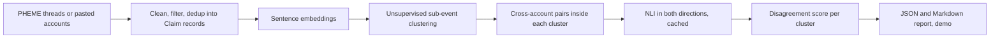
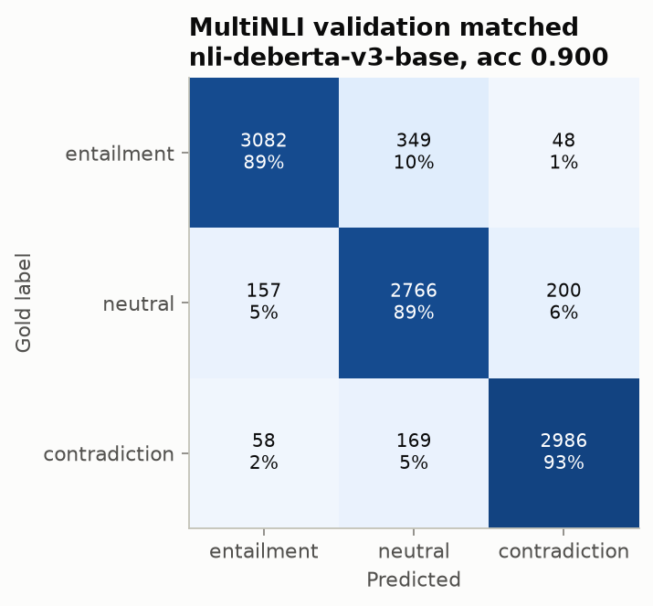
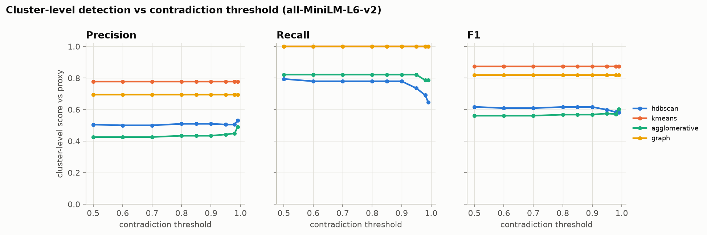
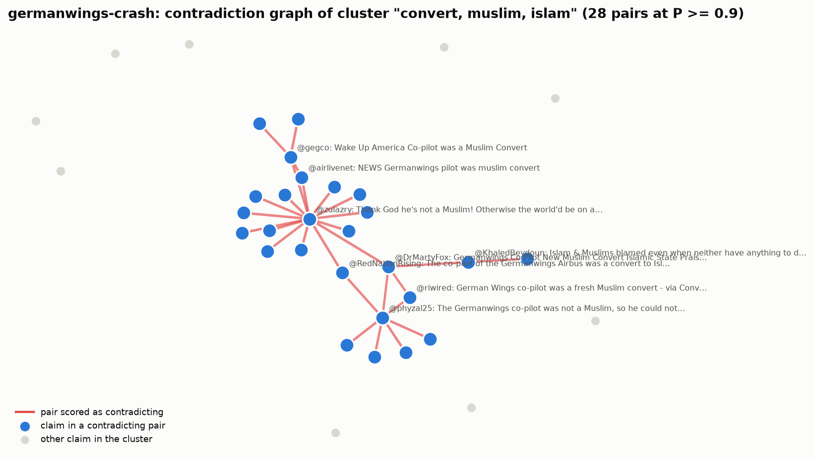

# Cross-Account Inconsistency Detector

**UML501 Machine Learning, group project.** Yash Aggarwal (data), Divit Malhotra (NLI scoring), Apoorv (clustering and integration).

All numbers in this report are read from `reports/results/*.json`, written by `python run_all.py`
on an RTX 4050 laptop GPU. Nothing is estimated or typed in from memory. Where a step was not run,
the report says so.

## Summary

Given many short accounts of one event, the system groups claims by sub-event without supervision,
scores claim pairs inside each group with a natural language inference (NLI) model, and lists the
groups whose accounts contradict each other. It never says which account is right.

- The NLI scorer reaches **90.0% accuracy** on both MultiNLI validation sets.
- Clustering cuts the claim pairs sent to the NLI model by **95%** (9,698 instead of 207,385 on the
  same 1,283 claims) and raises the share of flagged pairs that concern the same annotated rumour
  story from **2.1% to 27.1%**.
- Against the cluster-level proxy built from PHEME veracity labels, detection is **only modestly
  better than trivial baselines**: precision 0.51, recall 0.78, F1 0.62, against F1 0.57 for
  flagging every cluster and 0.48 for flagging at random.
- A manual audit of 40 random flagged pairs found **27.5% genuine disagreements, 15% time-driven
  conflicts and 57.5% false alarms**.
- The main weakness is the NLI model on tweets: it labels unrelated statements as contradictions
  with high confidence. The proxy labels are also weak, and understate the detector in both
  directions (see section 8).

## 1. Motivation

Investigators, journalists and fact-checkers often have to reconcile many independent accounts of
one incident. Reading every pair of statements does not scale: 2,000 tweets about the Charlie
Hebdo attack make about two million pairs. The useful output is not a verdict but a short list of
places where accounts differ, with the conflicting statements side by side and attributed, so a
person can decide what to check.

The system deliberately does **not** predict who is at fault, decide which account is correct,
write a single reconciled narrative, or use a generative language model in the detection loop.

## 2. Related work

- **Natural language inference.** MultiNLI (Williams, Nangia and Bowman, 2018) is a 433k-pair,
  multi-genre corpus labelled entailment / neutral / contradiction. Cross-encoders fine-tuned on
  it, such as DeBERTa-v3 (He et al., 2021), are the standard off-the-shelf contradiction scorers.
- **Rumour and stance datasets.** PHEME (Zubiaga et al., 2016) collects Twitter threads about
  breaking-news events, annotated as rumour or non-rumour; the extended release (Kochkina, Liakata
  and Zubiaga, 2018) adds veracity. RumourEval (Derczynski et al., 2017) added reply stance labels
  to a subset of PHEME threads; those labels are not in the releases used here.
- **Sentence embeddings and topic clustering.** Sentence-BERT (Reimers and Gurevych, 2019)
  provides the embeddings; HDBSCAN (Campello et al., 2013; McInnes et al., 2017) on UMAP-reduced
  embeddings is the recipe popularised by BERTopic (Grootendorst, 2022), from which the
  class-based TF-IDF cluster labels are also borrowed.
- **Contradiction detection across documents.** Earlier work (de Marneffe et al., 2008) already
  noted that real contradictions need the two statements to be about the same event, which is the
  role clustering plays here.

## 3. Data

### 3.1 MultiNLI

The only NLI dataset in the project. The scorer is a model already trained on it, used as is;
further fine-tuning is off by default and was not run. The validation sets are used as a sanity
check: 9,815 matched and 9,832 mismatched pairs after dropping pairs without annotator consensus.

### 3.2 PHEME

Nine events are on disk; the main experiments use four.

| Event | Source tweets | After cleaning and dedup | Accounts | Rumour claims | True / false / unverified | Rumour stories |
|---|---|---|---|---|---|---|
| Ottawa shooting | 890 | 871 | 434 | 463 | 322 / 72 / 69 | 51 |
| Sydney siege | 1,221 | 1,182 | 565 | 506 | 370 / 82 / 54 | 61 |
| Charlie Hebdo | 2,079 | 2,010 | 1,021 | 445 | 187 / 112 / 146 | 60 |
| Germanwings crash | 469 | 461 | 228 | 233 | 92 / 108 / 33 | 19 |

(Rumour claims are counted after deduplicating all source tweets. The evaluation set deduplicates rumour tweets only, which gives 447 instead of 445 for Charlie Hebdo.)

**What the annotations contain (verified on the local files).** Rumour threads have
`is_rumour`, `category` (the rumour story), `misinformation`, `true`, `links` and `is_turnaround`.
Non-rumour threads have `is_rumour` only. There are **no reply stance labels and no
entailment/contradiction labels** in either local release. Veracity is constant within a story:
no story mixes true and false threads.

**Unit of analysis.** A claim is one cleaned source tweet, and its account is the author. Replies
are loadable (`data.include_replies: true`) but are off in the main experiments: they are mostly
reactions and questions, not reports of what happened.

**Cleaning.** URLs, retweet markers and @mentions are removed; hashtags keep their words; emoji are
stripped; texts under four tokens are dropped; exact duplicates of the normalised text are folded
into the earliest tweet. Details are in `data/SCHEMA.md`.

**Language.** Tweets whose Twitter language tag is not English are dropped, because the NLI model
is English-only. Every source tweet of the four events is tagged English, so this only affects
replies (5.7% non-English for Ottawa). A multilingual embedder is configured for anyone who keeps
other languages, but it was not evaluated.

### 3.3 Proxy labels and their limits

Because PHEME has no contradiction labels, evaluation uses proxies. They are defined in
`data/proxy_labels.py` and are never presented as NLI gold.

| Level | Proxy label | Definition |
|---|---|---|
| Pair | contradiction-like | a turnaround (debunking) tweet of a **false** story, paired with a non-turnaround tweet of the same story |
| Pair | entailment-like | two non-turnaround tweets of the same **true** story |
| Pair | neutral-like | two tweets from different stories of the same event |
| Cluster | disagreement-positive | the cluster mixes tweets of a true story and a false story, or holds a false-story debunk together with a non-turnaround tweet of that story |
| Cluster (secondary) | contested | a false-story tweet shares the cluster with any tweet that is not from a false story |

Limits, all confirmed in the error analysis:

- Veracity belongs to the story, not the tweet. A tweet filed under a false story may itself be a
  denial, so "contradiction-like" pairs often agree with each other.
- Tweets of one true story can still conflict (an early "still alive" against a later "has died").
- Tweets from different stories are called neutral-like, yet some truly conflict ("148 on board"
  against "150 on board" are separate stories).
- Only 17 false-story turnaround tweets exist in the four events, so the contradiction-like class
  is small (205 pairs).
- The cluster-level proxy rewards large clusters: the larger a cluster, the more likely it mixes
  veracities. Cluster size alone ranks clusters about as well as the detector does.

## 4. Method

**Embeddings.** `all-MiniLM-L6-v2` (default) and `all-mpnet-base-v2` (comparison), unit-normalised.

**Clustering.** Four algorithms behind one interface: HDBSCAN on a 10-dimensional UMAP reduction;
k-means with k chosen by silhouette; average-linkage agglomerative clustering cut at cosine
distance 0.45; and a 10-nearest-neighbour similarity graph partitioned with Louvain. Points left
unclustered are attached to the nearest cluster centroid if the cosine similarity is at least 0.6;
otherwise they stay unclustered and are never compared, so they cannot produce a contradiction.

**Cluster labels.** The top class-based TF-IDF terms and the claim closest to the centroid. Both
are extractive.

**NLI scoring.** `cross-encoder/nli-deberta-v3-base`. The label order is read from the model
config. Each pair is scored in both directions with batching, half precision on GPU and a SQLite
cache. Only pairs inside a cluster and from different accounts are scored, at most 400 per cluster
(seeded random sample above that).

**Combining the two directions.** The default is `min_contradiction`: a pair counts as
contradicting only if both directions say so. This departs from the max-contradiction rule
suggested in the brief, because contradiction is symmetric and the stricter rule flagged 882 pairs
instead of 2,077 with slightly higher cluster-level precision (section 6.4). `max_contradiction`
and `mean` remain available in the config.

**Disagreement score.** For a cluster with scored pairs, a pair contradicts if its probability is
at least the threshold (0.9). The score is `0.5 * fraction of contradicting pairs + 0.5 * maximum
contradiction probability`, and the cluster is flagged if at least one pair contradicts.

**Output.** JSON plus Markdown. For each flagged cluster: label terms, central claim, counts, score,
and the top contradicting pairs with both texts, both accounts and the probabilities.

## 5. Experimental setup

- **Evaluation set:** the rumour source tweets of the four events (463, 506, 447 and 233 claims),
  because only they carry a story and a veracity. The per-event reports are produced on all
  source tweets.
- **Seeds and config:** seed 42 everywhere; all settings in `configs/default.yaml`.
- **Hyperparameters were set once, before evaluation, and not tuned on the proxy.** Two choices
  were made after seeing results and are disclosed as such: HDBSCAN as the default algorithm
  (best agreement with rumour stories) and `min_contradiction` aggregation.
- **Not run:** the optional comparison NLI model `roberta-large-mnli` (1.4 GB; the system drive
  had about 11 GB free), fine-tuning on MultiNLI, the multilingual embedder, and the Ferguson event.

## 6. Results

### 6.1 NLI scorer on MultiNLI

| Validation set | Pairs | Accuracy | Macro-F1 | Entailment P / R | Neutral P / R | Contradiction P / R |
|---|---|---|---|---|---|---|
| Matched | 9,815 | 0.9001 | 0.8998 | 0.935 / 0.886 | 0.842 / 0.886 | 0.923 / 0.929 |
| Mismatched | 9,832 | 0.9004 | 0.9001 | 0.930 / 0.893 | 0.839 / 0.881 | 0.932 / 0.927 |

The scorer behaves as published on in-domain data. Scoring ran at about 550 pairs per second.

### 6.2 NLI scorer on PHEME proxy pairs

3,405 proxy pairs (1,600 entailment-like, 1,600 neutral-like, 205 contradiction-like), scored
with the default both-directions aggregation.

| Metric | Value |
|---|---|
| Accuracy | 0.445 |
| Macro-F1 | 0.322 |
| Entailment-like: precision / recall | 0.674 / 0.094 |
| Neutral-like: precision / recall | 0.467 / 0.813 |
| Contradiction-like: precision / recall | 0.156 / 0.302 |
| Contradiction vs rest at threshold 0.9: precision / recall / F1 | 0.168 / 0.254 / 0.202 |

Two things explain the low scores. First, 240 of 1,600 pairs of tweets from *different* stories are
still predicted as contradictions even when both directions must agree (with the max rule it was
703): the model treats "about something else" as "conflicts". Second, most same-story pairs are
predicted neutral (1354 of 1,600), which is reasonable for tweets that add different details, but
counts as an error against "entailment-like". This table measures the mismatch between NLI and the
proxy as much as it measures the model. With max-contradiction aggregation the same pairs gave
accuracy 0.331 and macro-F1 0.273.

Share of proxy pairs scored at or above 0.9, by aggregation rule (computed from the cached
directional scores):

| Aggregation | Entailment-like | Neutral-like | Contradiction-like |
|---|---|---|---|
| max of the two directions | 13.3% | 37.8% | 52.2% |
| mean | 4.9% | 12.6% | 25.9% |
| min (both directions) | 4.3% | 11.9% | 25.4% |

Requiring both directions cuts false alarms on unrelated pairs by two thirds, at the cost of half
the recall on contradiction-like pairs.

### 6.3 Clustering

Mean over the four events. ARI and NMI compare clusters with the annotated rumour story; noise
points count as singletons.

| Embedding | Algorithm | Clusters | Unclustered | Silhouette | Davies-Bouldin | ARI | NMI |
|---|---|---|---|---|---|---|---|
| MiniLM | HDBSCAN | 43.2 | 1.1% | 0.162 | 2.04 | **0.424** | **0.706** |
| MiniLM | k-means | 7.5 | 0.0% | 0.196 | 2.58 | 0.252 | 0.488 |
| MiniLM | agglomerative | 25.5 | 2.5% | 0.206 | **1.74** | 0.273 | 0.631 |
| MiniLM | graph (Louvain) | 10.0 | 1.0% | 0.187 | 2.48 | 0.300 | 0.574 |
| mpnet | HDBSCAN | 42.2 | 0.6% | 0.155 | 1.97 | 0.281 | 0.679 |
| mpnet | k-means | 24.2 | 0.2% | 0.197 | 2.29 | 0.363 | 0.632 |
| mpnet | agglomerative | 21.5 | 2.7% | **0.209** | 1.76 | 0.262 | 0.637 |
| mpnet | graph (Louvain) | 10.8 | 0.5% | 0.183 | 2.46 | 0.322 | 0.621 |

- HDBSCAN on MiniLM agrees best with the rumour stories and finds a number of clusters (43) close
  to the number of stories (19 to 61 per event). It became the default.
- Silhouette is low for every method (0.16 to 0.21) and does not rank methods the way ARI does:
  tweets about one event sit close together, so sub-events are not well separated in embedding space.
- The larger mpnet model is not better than MiniLM here.
- Results vary by event. HDBSCAN on mpnet finds only 5 clusters for Germanwings (ARI 0.18) but 51
  for Charlie Hebdo (ARI 0.42).

Limits of the extrinsic check: rumour stories are an annotator's grouping of rumours, not a
ground-truth list of sub-events; many stories are singletons (20 of 51 for Ottawa), which
penalises any method that merges; and the comparison with thread grouping proposed in the brief is
uninformative for source tweets, because each source tweet is its own thread.

### 6.4 Full pipeline against the cluster-level proxy

Pooled over the four events, threshold 0.9, both-directions aggregation.

| Embedding | Algorithm | Clusters | Proxy-positive | Flagged | Precision | Recall | F1 | Avg. precision |
|---|---|---|---|---|---|---|---|---|
| MiniLM | HDBSCAN (default) | 172 | 68 | 104 | 0.510 | 0.779 | 0.616 | 0.495 |
| MiniLM | k-means | 30 | 21 | 27 | 0.778 | 1.000 | 0.875 | 0.830 |
| MiniLM | agglomerative | 102 | 28 | 53 | 0.434 | 0.821 | 0.568 | 0.639 |
| MiniLM | graph | 40 | 25 | 36 | 0.694 | 1.000 | 0.820 | 0.728 |
| mpnet | HDBSCAN | 159 | 45 | 79 | 0.342 | 0.600 | 0.435 | 0.342 |
| mpnet | k-means | 92 | 36 | 55 | 0.527 | 0.806 | 0.637 | 0.574 |
| mpnet | agglomerative | 87 | 28 | 46 | 0.500 | 0.821 | 0.622 | 0.498 |
| mpnet | graph | 43 | 27 | 39 | 0.692 | 1.000 | 0.818 | 0.794 |

**These rows are not comparable as a ranking.** Each configuration defines its own clusters, so
the base rate differs: with k-means on MiniLM there are 30 large clusters of which 70% are
proxy-positive, so flagging everything already gives precision 0.70. The high k-means and graph
scores reflect coarse clusters, not better detection.

Baselines on the default configuration's 172 clusters (39.5% proxy-positive):

| Method | Precision | Recall | F1 |
|---|---|---|---|
| Detector (default) | 0.510 | 0.779 | 0.616 |
| Flag every cluster | 0.395 | 1.000 | 0.567 |
| Random, same flag rate as the detector | 0.395 | 0.604 | 0.477 |
| Flag nothing (majority class) | 0.000 | 0.000 | 0.000 |

The detector is 11.5 points of precision above chance. That is a real but small gain. Against the
secondary "contested" proxy the result is similar (precision 0.529, recall 0.764, F1 0.625).

Per event (default configuration):

| Event | Clusters | Proxy-positive | Flagged | Precision | Recall | F1 |
|---|---|---|---|---|---|---|
| Ottawa shooting | 45 | 10 | 27 | 0.333 | 0.900 | 0.486 |
| Sydney siege | 56 | 27 | 33 | 0.576 | 0.704 | 0.633 |
| Charlie Hebdo | 45 | 18 | 33 | 0.485 | 0.889 | 0.627 |
| Germanwings crash | 26 | 13 | 11 | 0.818 | 0.692 | 0.750 |

Germanwings works best: its rumours are crisp factual claims (a distress call was or was not sent,
148 or 150 people on board). Ottawa works worst: most of its stories are true, and its tweets
differ mainly in timing and detail.

Aggregation ablation (default embedding and clustering):

| Aggregation | Flagged pairs | Flagged clusters | Precision | Recall | F1 | Debunk pairs flagged |
|---|---|---|---|---|---|---|
| max_contradiction | 2,077 | 134 of 172 | 0.463 | 0.912 | 0.614 | 22.9% |
| mean | 929 | 104 | 0.510 | 0.779 | 0.616 | 12.2% |
| min_contradiction (default) | 882 | 104 | 0.510 | 0.779 | 0.616 | 11.7% |

Threshold sweep (default configuration):

| Threshold | 0.5 | 0.6 | 0.7 | 0.8 | 0.9 | 0.95 | 0.98 | 0.99 |
|---|---|---|---|---|---|---|---|---|
| Flagged clusters | 107 | 106 | 106 | 104 | 104 | 99 | 93 | 83 |
| Precision | 0.505 | 0.500 | 0.500 | 0.510 | 0.510 | 0.505 | 0.505 | 0.530 |
| Recall | 0.794 | 0.779 | 0.779 | 0.779 | 0.779 | 0.735 | 0.691 | 0.647 |
| F1 | 0.617 | 0.609 | 0.609 | 0.616 | 0.616 | 0.599 | 0.584 | 0.583 |

The curves are flat. The NLI model's contradiction probabilities are bimodal (near 0 or near 1), so
moving the threshold between 0.5 and 0.9 changes almost nothing. The threshold is not a useful
control for this model; a stricter flag rule or a relevance filter would be.

### 6.5 Effect of clustering: all-pairs baseline

All-pairs NLI was run on at most 350 claims per event (1,283 claims in total, 207,385 cross-account
pairs) and compared with clustering on the same claims, without the per-cluster pair cap.

| | All pairs, no clustering | In-cluster pairs |
|---|---|---|
| Pairs scored | 207,385 | 9,698 (95.4% fewer) |
| Pairs flagged at 0.9 | 28,735 | 1,022 |
| Flagged pairs about the same rumour story | 2.1% | 27.1% |
| Flagged pairs matching the conflict proxy (true vs false story, or debunk pair) | 21.3% | 11.3% |
| Debunk pairs kept together | 145 of 145 | 67 of 145 (46.2%) |
| Debunk pairs flagged | 36 (24.8%) | 17 (11.7%) |
| NLI time on the GPU | about 11 minutes | under 1 minute |

Clustering makes the output usable: 1,022 flagged pairs instead of 28,735, and they are 13 times
more likely to concern the same story. It costs recall: more than half of the debunk pairs are
split across clusters and never compared. The conflict-proxy rate is higher for all pairs, but
that proxy is satisfied by any true-story tweet paired with any false-story tweet, related or not,
so it mostly measures how many cross-story pairs there are.

On full events the saving is larger: for Charlie Hebdo, 10,100 pairs are scored instead of 2,019,045.

### 6.6 Per-event reports on all source tweets

| Event | Claims | Clusters | Unclustered | Pairs scored | All pairs would be | Flagged clusters |
|---|---|---|---|---|---|---|
| Ottawa shooting | 871 | 82 | 17 | 4,592 | 378,885 | 48 |
| Sydney siege | 1,182 | 121 | 24 | 7,591 | 697,971 | 72 |
| Charlie Hebdo | 2,010 | 223 | 62 | 10,100 | 2,019,045 | 141 |
| Germanwings crash | 461 | 47 | 8 | 2,573 | 106,030 | 22 |

Between 47% and 63% of clusters are flagged. That is too many for the list to be a shortlist by
itself; a reader should sort by disagreement score and start at the top. The reports are written
to `outputs/reports/` (not versioned, because they quote thousands of tweets).

Example of what a flagged cluster looks like (Germanwings, cluster "send, distress signal, did"):
three tweets say a distress signal was sent, eight say it was not, and the heatmap separates the
two groups cleanly.

### 6.7 Manual audit and error analysis

Full details and 18 commented examples are in [`ERROR_ANALYSIS.md`](ERROR_ANALYSIS.md).

| Judgement of 40 random flagged pairs | Pairs | Share |
|---|---|---|
| Genuine disagreement about the same fact | 11 | 27.5% |
| Time-driven conflict (the situation changed) | 6 | 15.0% |
| Not a contradiction | 23 | 57.5% |

The judgements were made by a single reader (the AI assistant that built the pipeline) and have
not been checked by a second annotator. With 40 pairs, the 95% interval for "genuine or
time-driven" is roughly 27% to 59%.

Main findings:

- Of nine sampled "false positives" against the proxy, five are real conflicts the proxy cannot
  see ("still alive" against "has died" inside a true story).
- Of nine sampled "false negatives", six are pairs of tweets that both debunk the rumour and so
  agree with each other.
- Real model errors come from attribution phrases ("AFP says" against "CTV reports"), headline
  fragments with no proposition, entity aliases ("Charb" and "Stephane Charbonnier"), and numbers
  that count different things (142 passengers and 150 people on board).

## 7. Runtime

Measured on an RTX 4050 laptop GPU (6 GB), Windows 11, Python 3.11.

| Step | Time |
|---|---|
| NLI stage (MultiNLI 19,647 pairs + proxy pairs) | 48 s |
| Clustering stage (2 embedders, 4 algorithms, 4 events) | 74 s |
| Pipeline stage, cold cache (8 configurations + all-pairs baseline) | 889 s, of which the all-pairs baseline is 641 s |
| Pipeline stage, warm cache | 94 s |
| Per-event reports on all source tweets | 117 s |
| First read of PHEME from disk (about 100,000 small files) | several minutes; cleaned claims are cached afterwards |

A cold full run is therefore about 20 minutes plus model downloads (about 1.2 GB) and the first
PHEME read. Sample mode timings on CPU are in the README.

## 8. Limitations

1. **No gold labels.** Every PHEME score is against a proxy. The proxy marks real conflicts as
   false positives and agreeing debunks as false negatives, so the precision and recall figures
   are indicative only. The manual audit is small and single-annotator.
2. **The NLI model over-predicts contradiction on tweets.** 38% of unrelated-story pairs score at
   or above 0.9 in at least one direction, and 12% in both.
3. **Too many clusters are flagged** (about half) for the output to be a shortlist without ranking.
4. **Clustering loses recall.** About half of the rumour-versus-debunk pairs land in different
   clusters and are never compared.
5. **No notion of time.** An update ("lockdown lifted") looks the same as a dispute.
6. **Large clusters are sampled.** At most 400 pairs per cluster are scored, so a contradiction in
   a big cluster can be missed.
7. **English only**, source tweets only, four events. Replies, other languages and other domains
   (such as witness statements) were not evaluated. The demo accepts pasted free text, but that
   path has had only a smoke test.
8. **Cross-configuration comparisons are confounded** by cluster granularity (section 6.4).
9. **Deduplication removes verbatim agreement**, so the system measures disagreement among distinct
   wordings, not how many accounts back each side.

## 9. Ethics

- **The tool surfaces disagreement; it does not determine truth.** A flagged pair means two
  accounts appear to conflict according to a statistical model. It says nothing about which one
  is accurate, and nothing about honesty or fault. Every report carries that statement.
- **False alarms are frequent** (about 6 in 10 flagged pairs in the audit). Output must be read by
  a person and must not be used as evidence against anyone.
- **Witnesses disagree for innocent reasons:** different vantage points, different times, memory.
  Treating inconsistency as a sign of lying would be a misuse.
- **Privacy.** The data are public tweets with account names. Reports quote them with attribution
  so claims can be traced; the per-event reports are kept out of version control, and anyone
  redistributing output should follow the platform's terms.
- **Bias.** The NLI model was trained on edited English text. It may behave worse on dialects,
  informal writing and translated text, which would unevenly raise false alarms for some writers.

## 10. Future work

- A relevance gate before NLI: compare two claims only if they share an entity and a predicate.
- Use timestamps to separate "superseded by a later report" from "disputed".
- Strip attribution phrases and resolve entity aliases before scoring.
- Collect a few hundred pair-level human labels on PHEME to replace the proxy, with two annotators.
- Fine-tune or calibrate the NLI model on in-domain tweet pairs; compare `roberta-large-mnli`.
- Use RumourEval stance labels (support / deny / query / comment) for the PHEME threads they cover.
- Rank flagged clusters by a calibrated score so the top of the list is reliable.
- Evaluate on witness-statement style text, the original motivating use case.

## 11. Reproducing

See the repository `README.md` for exact commands. In short: create the environment, then
`python run_all.py` regenerates every number and figure in this report, and
`python run_all.py --sample` runs a small subset.

## References

- Campello, Moulavi and Sander (2013). Density-based clustering based on hierarchical density estimates. PAKDD.
- de Marneffe, Rafferty and Manning (2008). Finding contradictions in text. ACL.
- Derczynski et al. (2017). SemEval-2017 Task 8: RumourEval. SemEval.
- Grootendorst (2022). BERTopic: neural topic modeling with a class-based TF-IDF procedure. arXiv:2203.05794.
- He, Gao and Chen (2021). DeBERTaV3. arXiv:2111.09543.
- Kochkina, Liakata and Zubiaga (2018). All-in-one: multi-task learning for rumour verification. COLING.
- McInnes, Healy and Astels (2017). hdbscan: hierarchical density based clustering. JOSS.
- Reimers and Gurevych (2019). Sentence-BERT. EMNLP.
- Williams, Nangia and Bowman (2018). A broad-coverage challenge corpus for sentence understanding through inference. NAACL.
- Zubiaga, Liakata, Procter, Wong Sak Hoi and Tolmie (2016). Analysing how people orient to and spread rumours in social media. PLOS ONE.
