# Cross-Account Inconsistency Detector

**UML501 Machine Learning, group project.** Yash Aggarwal (data), Divit Malhotra (NLI scoring), Apoorv (clustering and integration).

All numbers in this report come from `reports/results/*.json`, written by `python run_all.py` on an
RTX 4050 laptop GPU. The tables are copied from [`RESULTS_TABLES.md`](RESULTS_TABLES.md), which is
generated from those files by `python -m evaluation.make_tables`. Where a step was not run, the
report says so.

## Summary

Given many short accounts of one event, the system groups claims by sub-event without supervision,
scores claim pairs inside each group with a natural language inference (NLI) model, and reports
where accounts conflict, what they agree on and what only one account says. It never says which
account is right.

- The NLI scorer reaches **90.0% accuracy** on both MultiNLI validation sets.
- On **5,413 human-labelled PHEME tweet pairs** (25.5% contradictions), the scorer's contradiction
  flags are **61.9% precise at 32.9% recall** with no clustering.
- Clustering first raises precision on those pairs to **67.2%** and cuts the false-alarm rate on
  unrelated pairs from 9.4% to 1.2%, but recall falls to **13.2%**, because only 55% of the
  labelled contradictions end up in the same cluster.
- Clustering also cuts the pairs sent to the NLI model by **82%** on a like-for-like comparison,
  and by more than 99% on a full event.
- The clustering that best matches the annotated rumour stories (HDBSCAN) turned out to be the
  worst for this task: it keeps only 10% of labelled contradictions together. The default is now
  agglomerative clustering.
- A manual audit of 40 random flagged pairs found 27.5% genuine disagreements, 15% time-driven
  conflicts and 57.5% false alarms (done on the earlier HDBSCAN configuration).

- **Fine-tuning the NLI model** on the labelled pairs, tested on an event it never saw, raises
  contradiction recall from 30.8% to 63.5% on average across four events (precision 58.4% to
  62.9%), and pipeline recall from 11.8% to 35.7%. It does not help on every event (section 6.10).

In short: the pipeline surfaces real conflicts at a precision of roughly two in three on labelled
data. The off-the-shelf NLI model misses most of them; fine-tuning on held-out events catches about
twice as many, and clustering then becomes the main limit on recall.

## 1. Motivation

Investigators, journalists and fact-checkers often have to reconcile many independent accounts of
one incident. Reading every pair of statements does not scale: 2,010 tweets about the Charlie
Hebdo attack make about two million pairs. The useful output is not a verdict but a short list of
places where accounts differ, with the conflicting statements side by side and attributed, so a
person can decide what to check.

The system deliberately does **not** predict who is at fault, decide which account is correct,
write a single reconciled narrative, or use a generative language model in the detection loop.

## 2. Related work

- **Natural language inference.** MultiNLI (Williams, Nangia and Bowman, 2018) is a 433k-pair,
  multi-genre corpus labelled entailment / neutral / contradiction. Cross-encoders fine-tuned on
  it, such as DeBERTa-v3 (He et al., 2021), are the standard off-the-shelf contradiction scorers.
- **Rumour datasets.** PHEME (Zubiaga et al., 2016) collects Twitter threads about breaking-news
  events, annotated as rumour or non-rumour; the extended release (Kochkina, Liakata and Zubiaga,
  2018) adds veracity. A separate PHEME release pairs rumour tweets and labels the pairs
  entailment / contradiction / unknown (to our knowledge Lendvai et al., 2016; the citation should
  be checked against the dataset's own documentation, which is not in the local copy).
- **Sentence embeddings and topic clustering.** Sentence-BERT (Reimers and Gurevych, 2019)
  provides the embeddings; HDBSCAN (Campello et al., 2013; McInnes et al., 2017) on UMAP-reduced
  embeddings is the recipe popularised by BERTopic (Grootendorst, 2022), from which the
  class-based TF-IDF cluster labels are also borrowed.
- **Contradiction detection across documents.** Earlier work (de Marneffe et al., 2008) already
  noted that real contradictions need the two statements to be about the same event, which is the
  role clustering plays here.

## 3. Data

### 3.1 MultiNLI

The only NLI training corpus in the project. The scorer is a model already trained on it, used as
is; further fine-tuning is off by default and was not run. The validation sets are used as a sanity
check: 9,815 matched and 9,832 mismatched pairs after dropping pairs without annotator consensus.

### 3.2 PHEME rumour threads

Nine events are on disk; the main experiments use four.

| Event | Source tweets | After cleaning and dedup | Accounts | Rumour claims | True / false / unverified | Rumour stories |
|---|---|---|---|---|---|---|
| Ottawa shooting | 890 | 871 | 434 | 463 | 322 / 72 / 69 | 51 |
| Sydney siege | 1,221 | 1,182 | 565 | 506 | 370 / 82 / 54 | 61 |
| Charlie Hebdo | 2,079 | 2,010 | 1,021 | 445 | 187 / 112 / 146 | 60 |
| Germanwings crash | 469 | 461 | 228 | 233 | 92 / 108 / 33 | 19 |

(Rumour claims are counted after deduplicating all source tweets. The evaluation set deduplicates
rumour tweets only, which gives 447 instead of 445 for Charlie Hebdo.)

**What the thread annotations contain (verified on the local files).** Rumour threads have
`is_rumour`, `category` (the rumour story), `misinformation`, `true`, `links` and `is_turnaround`.
Non-rumour threads have `is_rumour` only. The thread release has no reply stance labels and no
pair labels. Veracity is constant within a story.

**Unit of analysis.** A claim is one cleaned source tweet, and its account is the author. Replies
are loadable (`data.include_replies: true`) but are off in the main experiments: they are mostly
reactions and questions, not reports of what happened.

**Cleaning.** URLs, retweet markers and @mentions are removed; hashtags keep their words; emoji are
stripped; texts under four tokens are dropped; exact duplicates of the normalised text are folded
into the earliest tweet. Details are in `data/SCHEMA.md`.

**Language.** Tweets whose Twitter language tag is not English are dropped, because the NLI model
is English-only. Every source tweet of the four events is tagged English, so this only affects
replies (5.7% non-English for Ottawa).

### 3.3 PHEME RTE: labelled tweet pairs (primary evaluation data)

`pheme_rte_datasets_2016/` holds tweet pairs from the same four events with a pair label. After
dropping duplicate ids and identical texts: **5,413 pairs** (1,989 entailment, 2,046 unknown,
1,378 contradiction) over 533 distinct tweets. 5,230 pairs map onto our rumour claims by tweet id.

What the files show about how the labels were made: every entailment pair names one rumour story,
and every contradiction or unknown pair names two. So the label comes through the pair's stories
(same story, two conflicting stories, two unrelated stories), not from reading each tweet pair in
isolation. Consequences:

- It is a human-defined pair-level reference, far closer to the task than veracity.
- It is still coarser than sentence-level NLI. Two tweets of one story are "entailment" even if
  they add different details, and some "contradiction" pairs are about competing claims that are
  not logical opposites (for example "Parliament Hill is on lockdown" against "University of
  Ottawa is on lockdown").
- "Unknown" is treated as neutral.

This dataset reached the repository after the first round of experiments, which is why the
veracity proxies below exist at all.

### 3.4 Veracity proxies (secondary)

Built from the thread annotations in `data/proxy_labels.py`; never presented as NLI gold.

| Level | Proxy label | Definition |
|---|---|---|
| Pair | contradiction-like | a turnaround (debunking) tweet of a **false** story, paired with a non-turnaround tweet of the same story |
| Pair | entailment-like | two non-turnaround tweets of the same **true** story |
| Pair | neutral-like | two tweets from different stories of the same event |
| Cluster | disagreement-positive | the cluster mixes tweets of a true story and a false story, or holds a false-story debunk together with a non-turnaround tweet of that story |

Known problems, confirmed in the error analysis: a tweet filed under a false story may itself be a
denial, so "contradiction-like" pairs often agree; tweets of one true story can still conflict;
and the cluster proxy rewards large clusters. These proxies are kept for the cluster-level view
only, and are the weaker evidence wherever they disagree with section 3.3.

## 4. Method

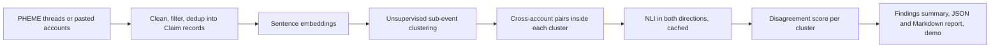

**Embeddings.** `all-MiniLM-L6-v2` (default) and `all-mpnet-base-v2` (comparison), unit-normalised.

**Clustering.** Four algorithms behind one interface: average-linkage agglomerative clustering cut
at cosine distance 0.45 (default); HDBSCAN on a 10-dimensional UMAP reduction; k-means with k
chosen by silhouette; and a 10-nearest-neighbour similarity graph partitioned with Louvain. Points
left unclustered are attached to the nearest cluster centroid if the cosine similarity is at least
0.6; otherwise they stay unclustered and are never compared.

**Cluster labels.** The top class-based TF-IDF terms and the claim closest to the centroid. Both
are extractive.

**NLI scoring.** `cross-encoder/nli-deberta-v3-base`. The label order is read from the model
config. Each pair is scored in both directions with batching, half precision on GPU and a SQLite
cache. Only pairs inside a cluster and from different accounts are scored, at most 400 per cluster
(seeded random sample above that).

**Combining the two directions.** The default is `min_contradiction`: a pair counts as
contradicting only if both directions say so. This departs from the max-contradiction rule
suggested in the brief. Contradiction is symmetric, and on the labelled pairs the stricter rule
gives precision 0.62 instead of 0.45 (section 6.2). `max_contradiction` and `mean` remain available.

**Disagreement score.** A pair contradicts if its probability is at least the threshold (0.9). The
cluster score is `0.5 * fraction of contradicting pairs + 0.5 * maximum contradiction probability`,
and the cluster is flagged if at least one pair contradicts.

**Findings summary.** Every report opens with a summary built only from the statements:

- *What the accounts agree on:* a statement that is not part of any flagged conflict and that
  another account also asserts (that account's claim entails it with probability at least 0.8).
- *Where the accounts conflict:* each flagged topic with its strongest conflicting pair.
- *Said by one account only:* statements that nobody restates and nobody contradicts.
- *What this summary cannot tell you:* fixed caveats (agreement is not proof, flags are prompts,
  time is not modelled, nothing says who is right).

The summary is extractive and makes no claim about truth. It has unit tests but has not been
evaluated for accuracy.

**Output.** JSON plus Markdown. For each flagged cluster: label terms, central claim, counts, score,
and the top contradicting pairs with both texts, both accounts and the probabilities.

## 5. Experimental setup

- **Labelled-pair evaluation (primary):** the 5,413 PHEME RTE pairs. NLI is scored on every pair;
  for the pipeline view, each event's rumour tweets are clustered without deduplication and a pair
  counts as flagged only if both tweets share a cluster and the NLI score reaches the threshold.
- **Cluster-level evaluation (secondary):** rumour source tweets of the four events (463, 506, 447
  and 233 claims) against the veracity proxy.
- **Seeds and config:** seed 42 everywhere; all settings in `configs/default.yaml`.
- **Choices made after seeing results, disclosed as such:** the `min_contradiction` direction rule,
  and agglomerative clustering as the default. The latter was chosen on the labelled pairs
  themselves (section 6.4), so its figures on those pairs are optimistic as an estimate for new
  data. Thresholds and clustering parameters were set once and not tuned.
- **Fine-tuning (section 6.10):** leave-one-event-out on the RTE pairs, validated on a whole
  training event. Sections 6.1 to 6.9 use the zero-shot model.
- **Not run:** the optional comparison NLI model `roberta-large-mnli`, fine-tuning on MultiNLI,
  the multilingual embedder, and the Ferguson event.

## 6. Results

### 6.1 NLI scorer on MultiNLI

| Set | Pairs | Accuracy | Macro-F1 | Entailment P / R | Neutral P / R | Contradiction P / R |
|---|---|---|---|---|---|---|
| Matched | 9,815 | 0.9001 | 0.8998 | 0.935 / 0.886 | 0.842 / 0.886 | 0.923 / 0.929 |
| Mismatched | 9,832 | 0.9004 | 0.9001 | 0.930 / 0.893 | 0.839 / 0.881 | 0.932 / 0.927 |

The scorer behaves as published on in-domain data. Scoring ran at about 550 pairs per second.

### 6.2 NLI scorer on labelled PHEME pairs

5,413 pairs; a majority-class guesser gets 37.8% accuracy; 25.5% of pairs are contradictions.
No clustering is involved here.

| Direction rule | 3-class accuracy | Macro-F1 | Flagged | Contradiction precision | Recall | F1 | Avg. precision | Flag rate: entailment / unknown / contradiction |
|---|---|---|---|---|---|---|---|---|
| premise_to_hypothesis | 0.467 | 0.435 | 1,305 | 0.507 | 0.480 | 0.493 | 0.462 | 10.3% / 21.5% / 48.0% |
| max_contradiction | 0.427 | 0.392 | 1,725 | 0.452 | 0.565 | 0.502 | 0.475 | 15.5% / 31.2% / 56.5% |
| mean | 0.431 | 0.369 | 777 | 0.615 | 0.347 | 0.444 | 0.537 | 4.8% / 10.0% / 34.7% |
| min_contradiction (default) | 0.461 | 0.407 | 734 | 0.619 | 0.329 | 0.430 | 0.532 | 4.4% / 9.4% / 32.9% |

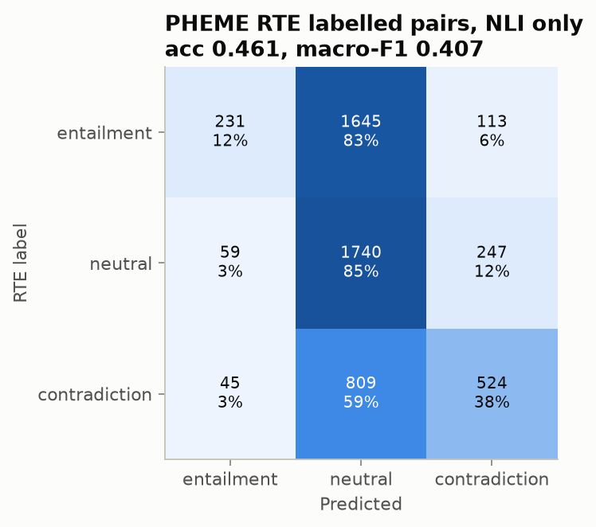

- **Three-class accuracy is poor (0.46).** The main reason is entailment: only 11.6% of labelled
  entailment pairs are predicted as entailment, and 83% are predicted neutral. Two tweets about
  the same story usually add different details, which the model correctly reads as "neither
  implies the other", while the dataset calls them entailment. This is partly a mismatch between
  story-level labels and sentence-level NLI.
- **Contradiction is what the project needs, and here the model is useful.** With the default
  rule a flagged pair is a labelled contradiction 62% of the time, 2.4 times the base rate.
- **Recall is the weak side:** one labelled contradiction in three is caught.
- **The direction rule is a precision/recall dial.** Max catches 57% at 45% precision; requiring
  both directions catches 33% at 62%. F1 is highest for max (0.50); average precision is highest
  for mean and min (0.53 to 0.54). We keep min because a shorter, cleaner list suits a tool whose
  output a person has to read.

Per event (default rule):

| Event | Pairs | Entailment / unknown / contradiction | 3-class accuracy | Contradiction precision | Recall |
|---|---|---|---|---|---|
| Ottawa shooting | 1,100 | 555 / 168 / 377 | 0.450 | 0.799 | 0.727 |
| Sydney siege | 1,214 | 332 / 565 / 317 | 0.509 | 0.596 | 0.177 |
| Charlie Hebdo | 1,936 | 643 / 866 / 427 | 0.465 | 0.395 | 0.234 |
| Germanwings crash | 1,163 | 459 / 447 / 257 | 0.414 | 0.545 | 0.093 |

Events differ a lot. Ottawa's labelled contradictions are mostly explicit ("still on the loose"
against "shot dead"). Germanwings' are mostly numeric ("148 on board" against "144 passengers and
6 crew"), which the model rarely scores as contradiction in both directions.

### 6.3 NLI scorer on the veracity-proxy pairs (secondary)

3,405 proxy pairs: accuracy 0.445, macro-F1 0.322; contradiction-like precision 0.168 and recall
0.254 at the threshold. These numbers are much worse than section 6.2, and the error analysis
shows why: most "contradiction-like" proxy pairs are two tweets that both deny the same rumour.
The proxy understates the scorer.

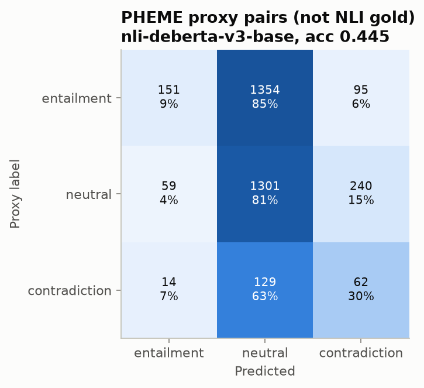

### 6.4 What clustering does to the labelled pairs

A pair is flagged by the pipeline only if both tweets are in the same cluster **and** the NLI
score reaches the threshold (5,230 mappable pairs, MiniLM embeddings).

| Clustering | Same cluster: entailment / unknown / contradiction | Flagged | Contradiction precision | Recall | F1 |
|---|---|---|---|---|---|
| HDBSCAN | 31.1% / 1.9% / 9.9% | 55 | 0.455 | 0.019 | 0.036 |
| k-means | 55.2% / 9.2% / 47.0% | 242 | 0.731 | 0.131 | 0.223 |
| agglomerative (default) | 73.0% / 18.5% / 55.1% | 265 | 0.672 | 0.132 | 0.221 |
| graph (Louvain) | 62.9% / 10.1% / 51.1% | 248 | 0.698 | 0.128 | 0.217 |
| no clustering (NLI on every pair) | 100% / 100% / 100% | 727 | 0.618 | 0.333 | 0.433 |

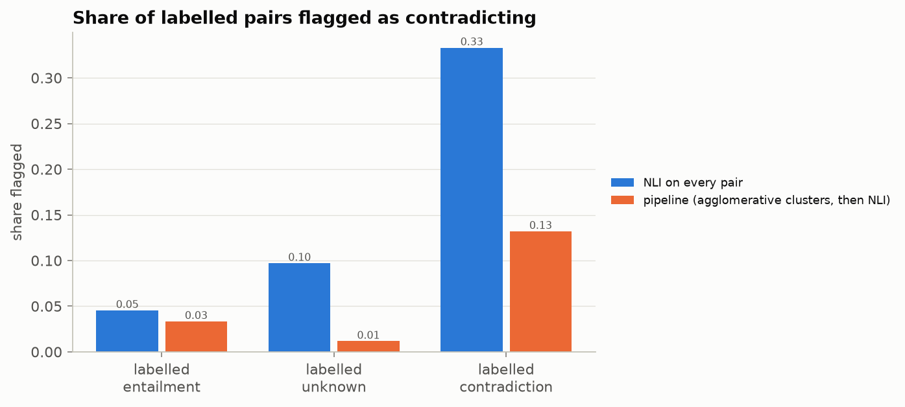

- **Clustering is a precision filter.** With agglomerative clusters, the share of labelled
  "unknown" pairs that get flagged drops from 9.4% to 1.2%, and precision rises from 0.62 to 0.67
  (0.73 with k-means).
- **It costs recall.** Only 55% of labelled contradictions share a cluster, so pipeline recall is
  13% against 33% for NLI alone. Clustering cannot add recall; it can only remove pairs.
- **HDBSCAN fails here.** It was the best match to the annotated rumour stories (section 6.5),
  but labelled contradictions are by construction between two *different* stories about the same
  thing. A clustering that reproduces stories faithfully therefore separates exactly the pairs
  that matter. This is why the default was changed to agglomerative, which keeps the most
  contradictions together.
- **These pairs flatter "no clustering".** The labelled set is curated: only 38% of its pairs are
  unrelated. In a real event almost all pairs are unrelated (section 6.7), so NLI on every pair
  would be far less precise there than the 0.62 measured here, and the filter matters more.

### 6.5 Clustering quality

Mean over the four events. ARI and NMI compare clusters with the annotated rumour story; noise
points count as singletons. UMAP, HDBSCAN and k-means show small run-to-run variation (second or
third decimal place) on this machine.

| Embedding | Algorithm | Clusters | Unclustered | Silhouette | Davies-Bouldin | ARI | NMI |
|---|---|---|---|---|---|---|---|
| MiniLM | HDBSCAN | 43.0 | 1.0% | 0.159 | 2.07 | **0.436** | **0.708** |
| MiniLM | k-means | 7.5 | 0.0% | 0.196 | 2.58 | 0.252 | 0.488 |
| MiniLM | agglomerative (default) | 25.5 | 2.5% | 0.206 | **1.74** | 0.273 | 0.631 |
| MiniLM | graph (Louvain) | 10.0 | 1.0% | 0.187 | 2.48 | 0.299 | 0.573 |
| mpnet | HDBSCAN | 39.8 | 0.5% | 0.159 | 2.00 | 0.307 | 0.685 |
| mpnet | k-means | 23.0 | 0.2% | 0.194 | 2.33 | 0.371 | 0.629 |
| mpnet | agglomerative | 21.8 | 2.7% | **0.208** | 1.75 | 0.262 | 0.638 |
| mpnet | graph (Louvain) | 10.8 | 0.5% | 0.184 | 2.46 | 0.325 | 0.621 |

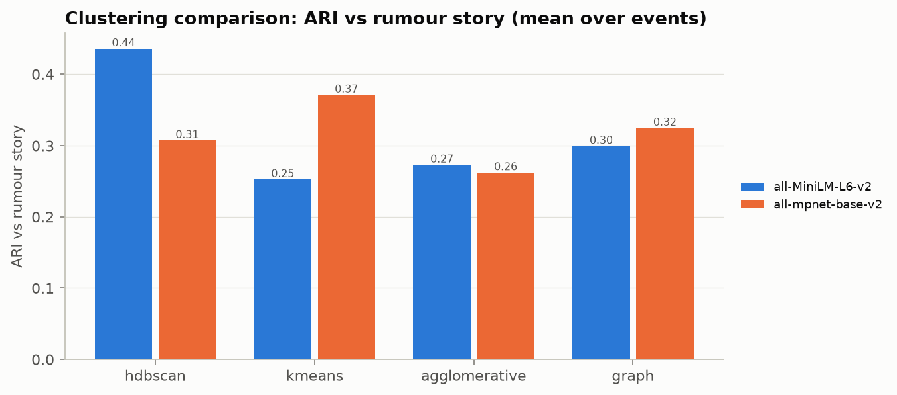
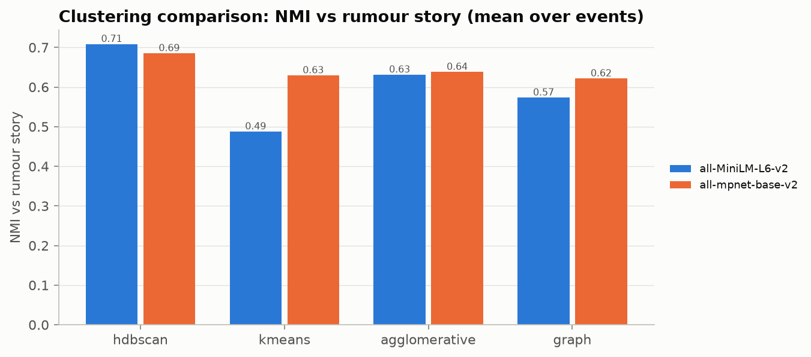
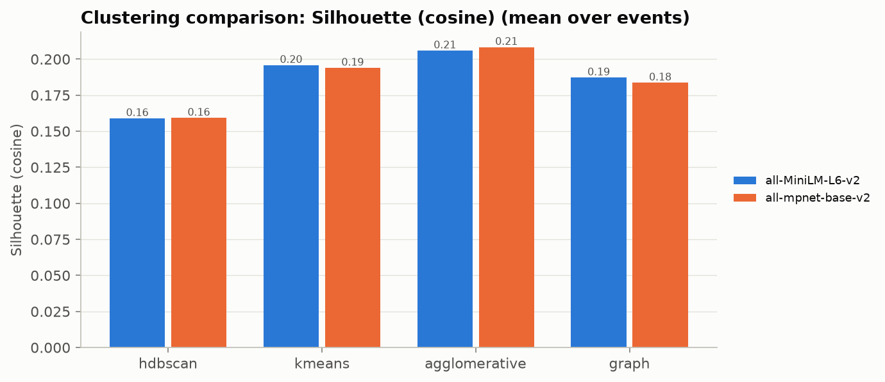

- HDBSCAN on MiniLM agrees best with the rumour stories. As section 6.4 shows, that is the wrong
  target for this task: the best "story" clustering is the worst contradiction filter.
- Agglomerative clustering has the best intrinsic scores (silhouette, Davies-Bouldin).
- Silhouette is low for every method (0.16 to 0.21): sub-events of one event overlap in embedding space.
- The larger mpnet model is not better than MiniLM.

Limits of the extrinsic check: rumour stories are an annotator's grouping, not a ground-truth list
of sub-events; many stories are singletons (20 of 51 for Ottawa); and the comparison with thread
grouping proposed in the brief is uninformative for source tweets, because each is its own thread.

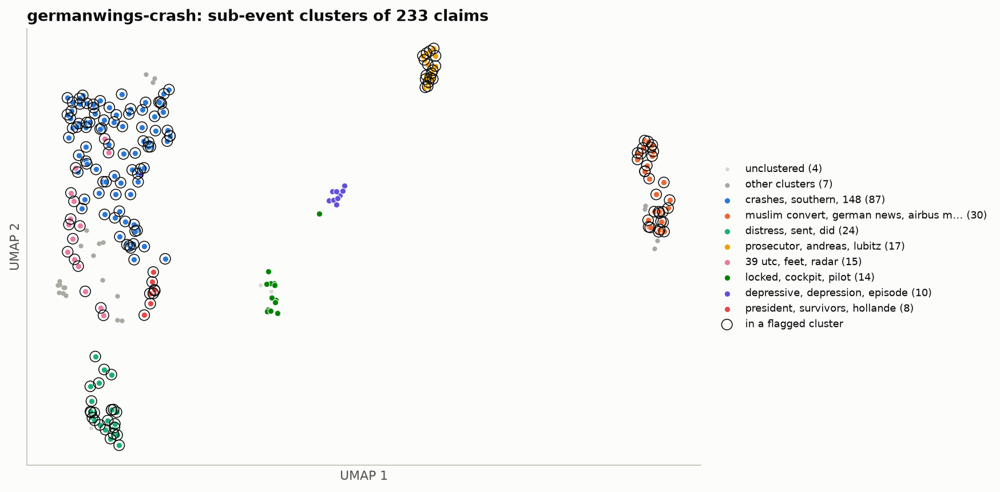

### 6.6 Full pipeline against the cluster-level veracity proxy (secondary)

Pooled over the four events, threshold 0.9, both-directions rule.

| Embedding | Algorithm | Clusters | Proxy-positive | Flagged | Precision | Recall | F1 | Avg. precision |
|---|---|---|---|---|---|---|---|---|
| MiniLM | HDBSCAN | 172 | 68 | 104 | 0.510 | 0.779 | 0.616 | 0.495 |
| MiniLM | k-means | 30 | 21 | 27 | 0.778 | 1.000 | 0.875 | 0.830 |
| MiniLM | agglomerative (default) | 102 | 28 | 53 | 0.434 | 0.821 | 0.568 | 0.639 |
| MiniLM | graph | 40 | 25 | 36 | 0.694 | 1.000 | 0.820 | 0.728 |
| mpnet | HDBSCAN | 159 | 45 | 79 | 0.342 | 0.600 | 0.435 | 0.342 |
| mpnet | k-means | 92 | 36 | 55 | 0.527 | 0.806 | 0.637 | 0.574 |
| mpnet | agglomerative | 87 | 28 | 46 | 0.500 | 0.821 | 0.622 | 0.498 |
| mpnet | graph | 43 | 27 | 39 | 0.692 | 1.000 | 0.818 | 0.794 |

**These rows are not comparable as a ranking.** Each configuration defines its own clusters, so
the base rate differs (27% proxy-positive for the default, 70% for k-means on MiniLM). High
k-means and graph scores reflect coarse clusters, not better detection.

Baselines on the default configuration's 102 clusters (27.5% proxy-positive):

| Method | Precision | Recall | F1 |
|---|---|---|---|
| Detector (default) | 0.434 | 0.821 | 0.568 |
| Flag every cluster | 0.275 | 1.000 | 0.431 |
| Random, same flag rate as the detector | 0.273 | 0.517 | 0.357 |
| Flag nothing (majority class) | 0.000 | 0.000 | 0.000 |

The detector is 16 points of precision above chance and catches 82% of proxy-positive clusters.

| Event | Clusters | Proxy-positive | Flagged | Precision | Recall | F1 |
|---|---|---|---|---|---|---|
| Ottawa shooting | 27 | 5 | 14 | 0.357 | 1.000 | 0.526 |
| Sydney siege | 34 | 9 | 17 | 0.412 | 0.778 | 0.538 |
| Charlie Hebdo | 26 | 6 | 16 | 0.312 | 0.833 | 0.455 |
| Germanwings crash | 15 | 8 | 6 | 1.000 | 0.750 | 0.857 |

Direction-rule ablation and threshold sweep (default embedding and clustering):

| Direction rule | Flagged pairs | Flagged clusters | Precision | Recall | F1 |
|---|---|---|---|---|---|
| max_contradiction | 2,044 | 66 of 102 | 0.394 | 0.929 | 0.553 |
| mean | 845 | 53 of 102 | 0.434 | 0.821 | 0.568 |
| min_contradiction (default) | 794 | 53 of 102 | 0.434 | 0.821 | 0.568 |

| Threshold | 0.5 | 0.6 | 0.7 | 0.8 | 0.9 | 0.95 | 0.98 | 0.99 |
|---|---|---|---|---|---|---|---|---|
| Flagged clusters | 54 | 54 | 54 | 53 | 53 | 52 | 49 | 45 |
| Precision | 0.426 | 0.426 | 0.426 | 0.434 | 0.434 | 0.442 | 0.449 | 0.489 |
| Recall | 0.821 | 0.821 | 0.821 | 0.821 | 0.821 | 0.821 | 0.786 | 0.786 |
| F1 | 0.561 | 0.561 | 0.561 | 0.568 | 0.568 | 0.575 | 0.571 | 0.603 |

The curves are flat: the model's contradiction probabilities sit near 0 or 1, so the threshold is
not a useful control between 0.5 and 0.95.

### 6.7 Effect of clustering on cost: all-pairs baseline

All-pairs NLI on at most 350 claims per event (1,283 claims), compared with in-cluster pairs on
the same claims, without the per-cluster pair cap.

| | All pairs, no clustering | In-cluster pairs |
|---|---|---|
| Pairs scored | 207,385 | 38,526 (81.7% fewer) |
| Pairs flagged at 0.9 | 28,735 | 3,910 |
| Flagged pairs about the same rumour story | 2.1% | 8.1% |
| Debunk pairs kept together | 145 of 145 | 73 of 145 |
| Debunk pairs flagged | 36 | 25 |

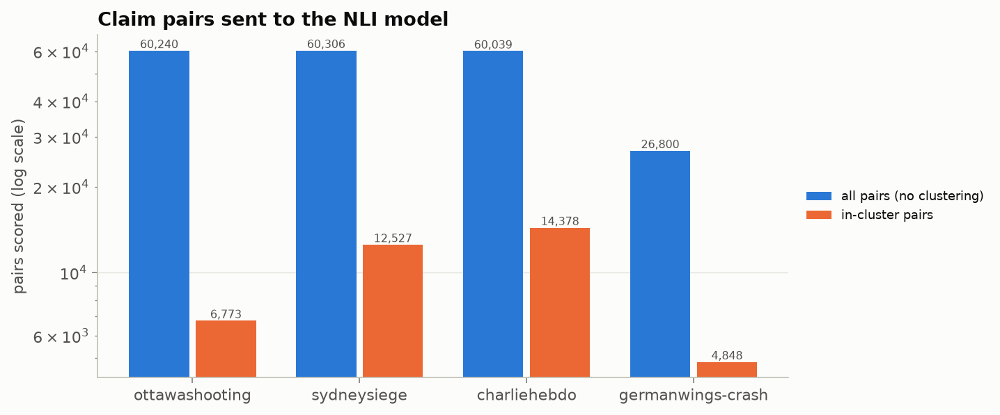
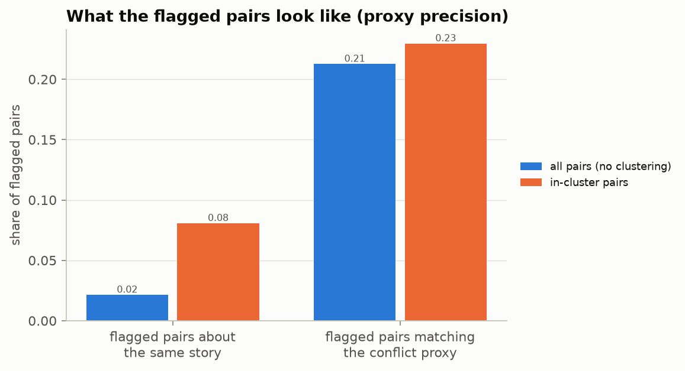

Without clustering the model flags 28,735 pairs, 98% of which compare tweets about different
stories. Clustering removes 86% of those flags. The agglomerative default produces a few very
large clusters, which is why the saving here (82%) is smaller than with HDBSCAN (95% in the
earlier run); in normal use the 400-pair cap per cluster bounds the cost.

### 6.8 Per-event reports on all source tweets

| Event | Claims | Clusters | Unclustered | Pairs scored | All pairs would be | Flagged clusters |
|---|---|---|---|---|---|---|
| Ottawa shooting | 871 | 67 | 39 | 4,182 | 378,885 | 28 |
| Sydney siege | 1,182 | 85 | 39 | 5,937 | 697,971 | 36 |
| Charlie Hebdo | 2,010 | 156 | 88 | 8,563 | 2,019,045 | 71 |
| Germanwings crash | 461 | 41 | 25 | 2,349 | 106,030 | 15 |

Between 37% and 46% of clusters are flagged, so a reader should sort by disagreement score and
start at the top. The reports are written to `outputs/reports/` (not versioned, because they quote
thousands of tweets).

Example (Germanwings, cluster "distress, sent, did"): one group of tweets says a distress signal
was sent, another says it was not, and the heatmap separates the two groups cleanly.

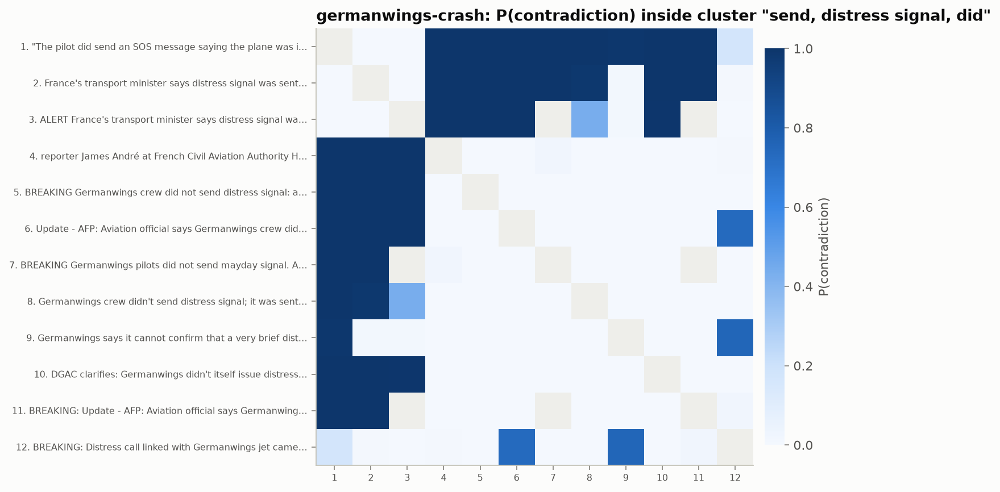

### 6.9 Manual audit and error analysis

Full details and 18 commented examples are in [`ERROR_ANALYSIS.md`](ERROR_ANALYSIS.md). **The audit
and the examples were made on the earlier HDBSCAN configuration** (882 flagged pairs; its
candidates are kept in `results/error_candidates_hdbscan.json`). They mostly describe the NLI
model's behaviour, which did not change, but they were not repeated for the new default.

| Judgement of 40 random flagged pairs | Pairs | Share |
|---|---|---|
| Genuine disagreement about the same fact | 11 | 27.5% |
| Time-driven conflict (the situation changed) | 6 | 15.0% |
| Not a contradiction | 23 | 57.5% |

The judgements were made by a single reader (the AI assistant that built the pipeline) and have
not been checked by a second annotator. With 40 pairs, the 95% interval for "genuine or
time-driven" is roughly 27% to 59%. The audit precision (42.5%) is lower than the 62 to 67%
measured on labelled pairs, which is expected: the audit sampled from all rumour tweets, where
unrelated pairs are far more common than in the curated labelled set.

Recurring model errors: attribution phrases ("AFP says" against "CTV reports"), headline fragments
with no proposition, entity aliases ("Charb" and "Stephane Charbonnier"), and numbers that count
different things (142 passengers and 150 people on board).

### 6.10 Fine-tuning the NLI model on the labelled pairs

**Method.** `cross-encoder/nli-deberta-v3-base` was fine-tuned on the PHEME RTE pairs with the
leave-one-event-out splits that ship with the dataset (`training/finetune_nli.py`, settings in
the `finetune` section of `configs/default.yaml`). Each fold trains on three events and tests on
the fourth.

- Labels: entailment, unknown as neutral, contradiction. The model keeps its 3-class head; label
  indices are read from its `id2label`.
- Every training pair is used in both orders with the same label. 3,000 random MultiNLI training
  examples are mixed in to limit forgetting. The loss is weighted by inverse class frequency.
- Learning rate 2e-5, batch 16, at most 3 epochs, warmup 10%, weight decay 0.01, fp16, seed 42.
- No train pair shares an id or a text pair with its test file (checked; nothing was removed).

**Validation.** Early stopping, the direction rule and the threshold were chosen on a
validation set drawn from the training events only. A random 10% of training pairs was tried
first and did not work: validation average precision reached 1.0 after one epoch. The training
events contain only 472 distinct tweets, each in about 18 pairs, and the labels follow rumour
stories, so a random pair split puts the same tweets and stories on both sides. Validation is
therefore one whole training event (Sydney for the Germanwings fold, Ottawa for Sydney, Germanwings
for Charlie Hebdo, Charlie Hebdo for Ottawa), and the model trains on the other two. The test
event is never used for training, stopping or choosing a threshold.

Two operating points are chosen on validation: best contradiction F1, and highest recall with
precision at least 0.55. The zero-shot model is reported both at the project default
(min_contradiction, 0.9) and at its own validation-tuned point, so the comparison is fair.

**Results.** Mean over the four held-out events (unweighted):

| Setting | 3-class acc. | Macro-F1 | Contr. P | Contr. R | Contr. F1 | Avg. precision | Flag rate: entailment / unknown / contradiction |
|---|---|---|---|---|---|---|---|
| Zero-shot, default (min, 0.9) | 0.460 | 0.379 | 0.584 | 0.308 | 0.372 | 0.504 | 4.3% / 7.0% / 30.8% |
| Zero-shot, validation-tuned best F1 | 0.438 | 0.372 | 0.452 | 0.547 | 0.449 | 0.468 | 16.5% / 32.2% / 54.7% |
| Fine-tuned, validation-tuned best F1 | 0.715 | 0.692 | 0.629 | 0.635 | 0.607 | 0.612 | 15.8% / 11.8% / 63.5% |

Per held-out event, fine-tuned (best F1 point) against zero-shot at the default:

| Held out | Test pairs | Best epoch | Contr. P | Contr. R | Contr. F1 | Pipeline P | Pipeline R |
|---|---|---|---|---|---|---|---|
| Germanwings crash | 1,163 | 1 | 0.545 → 0.467 | 0.093 → 0.922 | 0.159 → 0.620 | 0.571 → 0.535 | 0.033 → 0.611 |
| Sydney siege | 1,214 | 2 | 0.596 → 0.542 | 0.177 → 0.407 | 0.273 → 0.465 | 0.562 → 0.500 | 0.057 → 0.151 |
| Charlie Hebdo | 1,936 | 1 | 0.395 → 0.748 | 0.234 → 0.576 | 0.294 → 0.651 | 0.802 → 0.864 | 0.195 → 0.489 |
| Ottawa shooting | 1,100 | 1 | 0.799 → 0.761 | 0.727 → 0.634 | 0.761 → 0.692 | 0.602 → 0.593 | 0.188 → 0.178 |
| Mean | | | 0.584 → 0.629 | 0.308 → 0.635 | 0.372 → 0.607 | 0.634 → 0.623 | 0.118 → 0.357 |

"Pipeline" repeats the analysis of section 6.4 on the held-out event: agglomerative clusters,
and a pair counts as flagged only if both tweets share a cluster and the score reaches the
threshold. Confusion matrices are in `figures/confusion_finetune_leave_<event>.png`; every
setting, including the recall-at-precision mode, is in `RESULTS_TABLES.md`.

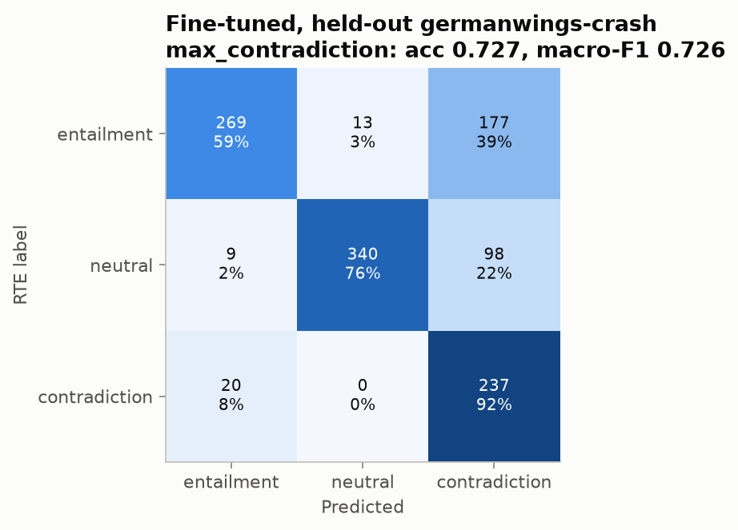

Clustering quality on the same held-out events (agglomerative, MiniLM, reference = annotated
rumour story). It does not depend on the NLI model:

| Event | Claims | Clusters | Stories | Silhouette | Davies-Bouldin | ARI | NMI | Homogeneity | Completeness | V-measure | Fowlkes-Mallows |
|---|---|---|---|---|---|---|---|---|---|---|---|
| Germanwings crash | 238 | 15 | 19 | 0.248 | 1.708 | 0.395 | 0.694 | 0.629 | 0.774 | 0.694 | 0.503 |
| Sydney siege | 520 | 34 | 61 | 0.174 | 1.740 | 0.145 | 0.559 | 0.480 | 0.668 | 0.559 | 0.262 |
| Charlie Hebdo | 458 | 26 | 60 | 0.184 | 1.656 | 0.089 | 0.561 | 0.450 | 0.745 | 0.561 | 0.214 |
| Ottawa shooting | 470 | 26 | 51 | 0.230 | 1.840 | 0.471 | 0.713 | 0.669 | 0.764 | 0.713 | 0.524 |

What this shows:

- **Fine-tuning roughly doubles contradiction recall on unseen events** (0.31 to 0.64) and
  raises 3-class accuracy from 0.46 to 0.72, with precision about the same (0.58 to 0.63).
  Through the pipeline, recall triples (0.12 to 0.36) at the same precision.
- **It is not a gain everywhere.** On Ottawa, where the zero-shot model was already good
  (explicit contradictions), the fine-tuned model is slightly worse. On Germanwings it finds
  92% of contradictions but also flags 39% of entailment pairs, and precision falls below the
  0.55 target that was met on validation.
- **Tuning the zero-shot threshold on validation does not do the same job.** It trades precision
  for recall (precision 0.45, recall 0.55) and flags a third of unrelated pairs.
- **The threshold carries little information for the fine-tuned model.** Its probabilities are
  close to 0 or 1, so the chosen thresholds range from 0.05 to 0.95 between folds with similar
  results, and several sit at the bottom of the search grid. In effect the model decides by its
  top label.
- **Overfitting is fast.** Training loss falls from about 0.3 to 0.03 to 0.05 in the second epoch while
  validation average precision drops in three folds of four; the best epoch was 1 in three folds.
- **Clustering now limits recall more than the NLI model.** On Ottawa the fine-tuned model alone
  finds 63% of contradictions but the pipeline 18%, because many contradicting tweets fall in
  different clusters. Sydney and Charlie Hebdo cluster worst against the stories (ARI 0.15 and
  0.09).

**Caveats.**

- The labels are story-level (section 3.3). The model can learn that two tweets come from
  competing stories rather than that they contradict each other, and the high entailment flag
  rate on Germanwings is consistent with that. The test event's stories are new, which limits
  but does not remove this.
- Folds are small (1,100 to 1,936 test pairs, one event each) and differ a lot, so the mean
  hides a wide spread. Each fold was trained once with one seed; no variance across seeds is
  reported.
- Thresholds and the direction rule were chosen on validation only, but the validation scheme
  itself (a whole event) was chosen after seeing the random split fail on the first fold,
  whose test scores had also been seen. No training setting was changed after that.
- The all-events model used by the demo (`finetuned/nli-deberta-v3-base-pheme-all`) is trained on
  every labelled pair for one epoch (median best epoch) with the median fold threshold. It has no
  test set of its own, and any number measured with it on PHEME RTE pairs would be on training
  data.

**Direction rule for the demo.** The folds mostly chose `max_contradiction` (one direction is
enough). On the example witness accounts this flags "The driver stayed at the scene" against
"The driver got out and called an ambulance", which agree. The zero-shot model makes the same
error with full confidence in both directions; the fine-tuned model calls it neutral in one
direction and contradiction in the other. The rules were then compared on the four validation
events only, at the demo threshold of 0.5 (`direction_rules_on_validation` in the results):

| Rule (mean of 4 validation events) | Contr. P | Contr. R | Contr. F1 | Flag rate: entailment / unknown |
|---|---|---|---|---|
| max_contradiction | 0.699 | 0.606 | 0.641 | 10.3% / 8.1% |
| mean | 0.737 | 0.532 | 0.616 | 6.5% / 6.1% |
| min_contradiction (demo) | 0.770 | 0.424 | 0.547 | 3.7% / 4.0% |

The demo uses `min_contradiction` (`finetune.aggregation_override`), for the same reason as the
zero-shot default (section 4): a person reads every flag, so a shorter, cleaner list is worth more
than recall. This removes the driver false alarm but also loses a real one on the same example
("ran the red light" against "the light was green"), which the fine-tuned model scores as a
contradiction in one direction only. The leave-one-event-out results above keep the rules chosen
by the fold procedure; the override was chosen after looking at one example and the validation
events, not the test events.

### 6.11 Evaluation validity: independent units, intervals and baselines

Added after an external review (`critic/REPORT.md`). Every number here is generated by
`python -m evaluation.validity` and printed in `RESULTS_TABLES.md` ("Evaluation validity").

**The labelled pairs hold few independent units.** A PHEME RTE label is a deterministic function
of the two rumour stories a pair belongs to: grouping the 5,413 pairs by (event, stories) gives 85
groups, none with mixed labels. The 1,378 contradictions come from 21 story pairs, and Germanwings
has one ("up to 150 perished" against "148 on board"), so its recall is the hit rate on a single
conflict. Pairs inside a group are not independent, so all intervals below resample whole story
groups within each event (2,000 resamples, 95% percentile intervals). For the zero-shot default
this widens the F1 interval from 0.050 (resampling pairs) to 0.434.

**Baselines at pair level.** On all labelled pairs the zero-shot default (min rule, 0.9) has F1
0.430 [0.196, 0.630]. Flagging every pair gives 0.406, and three untuned keyword cues (negation,
number or antonym mismatch) give 0.476. The paired difference to flag-all is +0.02 [-0.22, +0.25].
The default buys precision (0.62 against 0.26) at the cost of recall; it is not better in F1.

**Fine-tuning against the fair reference.** Pooled over the four held-out events, with each pair
scored by its own fold's model at that fold's validation-chosen operating point:

| System | Contr. P | Contr. R | Contr. F1 |
|---|---|---|---|
| zero-shot, default (min, 0.9) | 0.619 | 0.329 | 0.430 [0.196, 0.630] |
| zero-shot, validation-tuned | 0.424 | 0.588 | 0.492 [0.237, 0.678] |
| fine-tuned, validation-tuned | 0.613 | 0.618 | 0.615 [0.347, 0.747] |
| keyword cues | 0.467 | 0.485 | 0.476 [0.185, 0.676] |
| story oracle (two stories and similar wording; reads the label structure) | 0.529 | 0.781 | 0.631 [0.432, 0.767] |

Fine-tuned minus validation-tuned zero-shot: F1 +0.12 [-0.08, +0.35], recall +0.03 [-0.25, +0.33].
The "doubles recall" figure of section 6.10 compares against the fixed 0.9 point, which is a
choice of operating point, not of model. Per event the F1 gain over the validation-tuned zero-shot
model is +0.28, +0.14, +0.20 and +0.00 (Germanwings, Sydney, Charlie Hebdo, Ottawa). Fine-tuning
beats the keyword cues (+0.14 [+0.03, +0.27]) but not the story oracle (-0.02 [-0.22, +0.13]),
which is consistent with part of the gain being story learning.

**Clustering.** Pipeline minus NLI-only on the labelled pairs: precision +0.05 [-0.11, +0.29],
recall -0.20 [-0.40, -0.05]. The precision gain is not significant; the recall loss is.

**Cluster level.** Flagging the k largest clusters (k = the detector's own flag count) gives F1
0.519 against the detector's 0.568; the difference is +0.05 [-0.02, +0.13]. Ranking clusters by
size alone has AP 0.680 against the proxy, above ranking by maximum contradiction (0.639) or by the
disagreement score (0.381). The veracity-proxy result is therefore mostly a cluster-size effect.

**Text layer for pasted accounts.** Three changes sit in front of the NLI stage for free-text
accounts (tweets are not affected): a sentence splitter that does not split after "Dr.", "St.",
"approx." and similar; clause splitting of sentences over 40 words, since premise and hypothesis
share the 128-token window (two long accounts that differ only in their last clause scored
entailment 0.998 because both were cut at the same place); and speaker grounding, which rewrites
"I", "my" and "we" to the account's name and drops a leading "I heard / I saw". On 23 witness-style
probe checks (`python -m evaluation.witness_probes`), applied one change at a time:

| Run | Passed |
|---|---|
| before (zero-shot) | 13 / 23 |
| + abbreviation-aware splitter | 18 / 23 |
| + clause splitting | 19 / 23 |
| + speaker grounding (with the perception rule) | 21 / 23 |
| fine-tuned model, before / after | 14 / 23, 22 / 23 |

Grounding without the perception rule fixed two first-person false alarms but lost a real one
("I heard two shots" against "I heard three shots", which the model then read as two different
hearers). Still failing: "my car was parked outside the bank" against "my car was in the garage"
(two different cars, contradiction 0.9999), and with the zero-shot model the example file's
"stayed at the scene" against "got out and called an ambulance". These need a check after the NLI
stage, not a text rewrite. The probes are hand-written and few; they show failure modes, not
rates.

## 7. Runtime

Measured on an RTX 4050 laptop GPU (6 GB), Windows 11, Python 3.11.

| Step | Time |
|---|---|
| NLI stage, cold (MultiNLI 19,647 pairs + proxy pairs) | 48 s |
| Labelled-pair (RTE) stage | 47 s cold, 41 s warm |
| Clustering stage (2 embedders, 4 algorithms, 4 events) | about 70 s |
| Pipeline stage, cold cache (8 configurations + all-pairs baseline; measured with the earlier HDBSCAN default) | 889 s, of which the all-pairs baseline is 641 s |
| Pipeline stage, warm cache | 91 s |
| Per-event reports on all source tweets | 41 to 117 s |
| Whole `run_all.py`, warm caches | 279 s |
| First read of PHEME from disk (about 100,000 small files) | several minutes; cleaned claims are cached afterwards |

A cold full run is about 20 minutes plus model downloads (about 1.2 GB) and the first PHEME read.
Sample mode on CPU with cold caches took 424 s before the labelled-pair stage was added; it has
not been re-timed since.

## 8. Limitations

1. **Recall is low.** On labelled pairs the pipeline finds about 13% of contradictions; NLI alone
   finds 33%. Fine-tuning raises these to 36% and 64% on held-out events (section 6.10), but most
   conflicts are still missed by the pipeline, mainly because contradicting claims fall in
   different clusters.
2. **Labels are story-level.** The RTE labels come through rumour stories, not per-pair reading,
   so some "contradictions" are competing claims and many "entailments" are loosely related.
3. **The default clustering was selected on the labelled pairs**, with no held-out split. Four
   options were compared and none was tuned, but the reported pipeline figures are still optimistic.
4. **The NLI model over-predicts contradiction on unrelated tweets** (9% of labelled unknown pairs
   at 0.9 even with the strict rule; 31% with the max rule).
5. **Too many clusters are flagged** (about 40%) for the output to be a shortlist without ranking.
6. **No notion of time.** An update ("lockdown lifted") looks the same as a dispute.
7. **Large clusters are sampled.** At most 400 pairs per cluster are scored.
8. **English only**, source tweets only, four events. Witness-statement style input has had a
   small made-up example and unit tests only.
9. **The findings summary is not evaluated.** "Agree" relies on the same NLI model's entailment
   score, which section 6.2 shows is conservative, so real agreement is under-reported.
10. **The manual audit is small, single-annotator, and from the earlier configuration.**
11. **Different descriptions of the same fact are read as contradictions.** Both models flag
    "stayed at the scene" against "got out and called an ambulance". The models match surface
    patterns (same person, different actions) and have no world knowledge linking the two.
    The PHEME pairs do not teach this, and the stricter demo rule only hides it when one
    direction disagrees.
12. **The fine-tuned model may have learned story cues.** It was trained on story-level labels,
    flags many entailment pairs on some events (39% on Germanwings), is slightly worse than the
    zero-shot model on Ottawa, and was trained once per fold with one seed. Its threshold is
    unstable across folds. The demo model has no held-out evaluation of its own.

## 9. Ethics

- **The tool surfaces disagreement; it does not determine truth.** A flagged pair means two
  accounts appear to conflict according to a statistical model. It says nothing about which one
  is accurate, and nothing about honesty or fault. Every report carries that statement.
- **"Accounts agree" is not "this is true".** Accounts can repeat one source or one mistake. The
  findings summary says so in every report.
- **False alarms are frequent** (about one in three flagged labelled pairs, more on raw events).
  Output must be read by a person and must not be used as evidence against anyone.
- **Witnesses disagree for innocent reasons:** different vantage points, different times, memory.
  Treating inconsistency as a sign of lying would be a misuse.
- **Privacy.** The data are public tweets with account names. Reports quote them with attribution
  so claims can be traced; the per-event reports are kept out of version control, and anyone
  redistributing output should follow the platform's terms.
- **Bias.** The NLI model was trained on edited English text. It may behave worse on dialects,
  informal writing and translated text, which would unevenly raise false alarms for some writers.

## 10. Future work

- Fine-tuning (section 6.10): repeat with several seeds, a lower learning rate or fewer steps
  (it overfits within one epoch), and a class-balanced validation event; test on pairs labelled
  sentence by sentence, or on a fifth event, to check for story cues; calibrate its
  probabilities so the threshold means something.
- Since clustering is now the main limit on recall, try comparing pairs across neighbouring
  clusters, or a looser clustering, with the fine-tuned scorer.
- Choose the clustering on a held-out event instead of on all labelled pairs.
- A relevance gate before NLI: compare two claims only if they share an entity and a predicate.
- Use timestamps to separate "superseded by a later report" from "disputed".
- Strip attribution phrases, resolve entity aliases and handle numeric claims explicitly.
- Repeat the manual audit on the current default with two annotators.
- Evaluate the findings summary, and test on witness-statement style text.

## 11. Reproducing

See the repository `README.md` for exact commands. In short: create the environment, then
`python run_all.py` regenerates every number and figure, and `python -m evaluation.make_tables`
regenerates the tables.

## References

- Campello, Moulavi and Sander (2013). Density-based clustering based on hierarchical density estimates. PAKDD.
- de Marneffe, Rafferty and Manning (2008). Finding contradictions in text. ACL.
- Grootendorst (2022). BERTopic: neural topic modeling with a class-based TF-IDF procedure. arXiv:2203.05794.
- He, Gao and Chen (2021). DeBERTaV3. arXiv:2111.09543.
- Kochkina, Liakata and Zubiaga (2018). All-in-one: multi-task learning for rumour verification. COLING.
- Lendvai, Augenstein, Bontcheva and Declerck (2016). Monolingual social media datasets for detecting contradiction and entailment. LREC. (Believed to be the source of the PHEME RTE pairs; verify.)
- McInnes, Healy and Astels (2017). hdbscan: hierarchical density based clustering. JOSS.
- Reimers and Gurevych (2019). Sentence-BERT. EMNLP.
- Williams, Nangia and Bowman (2018). A broad-coverage challenge corpus for sentence understanding through inference. NAACL.
- Zubiaga, Liakata, Procter, Wong Sak Hoi and Tolmie (2016). Analysing how people orient to and spread rumours in social media. PLOS ONE.
